# 02. 정보 구조 (IA)

- 상태: 초안 (2026-10-14). 홈 구성은 F1 기획에서(아래 "홈 시안"), `/work` 구성은 F2 기획에서(아래 "포트폴리오 시안") 정했습니다.

## 페이지

| 경로 | 내용 | 단계 |
|---|---|---|
| `/` | 홈(메인). 아래 섹션 순서 참고 | 1차 (F1) |
| `/work` | 포트폴리오. 세 서비스의 상세와 의뢰받아 만든 사이트 두 개를 한 페이지에 챕터로 잇습니다(`/work#slug`) | 1차 (F2) |
| `/ai` | AI로 일하는 방식. 아홉 항목을 네 묶음으로 한 페이지에 잇습니다(`/ai#slug`) | 1차 (F3) |
| `/ai/case` | AI 도구 활용 사례. 프로젝트 하나를 AI와 진행한 흐름을 4컷과 본문으로 보여 줍니다. 헤더 메뉴에는 없고 `/ai` 맨 위 입구로 들어갑니다 | 1차 뒤 추가 (2026-10-20) |
| `/resume` | 이력서 (인쇄용) | 1차 (F4) |
| `/en/...` | 영어 페이지 | 2차 |

섹션과 페이지마다 전달할 메시지, 담을 사실과 출처, 문구 초안, 움직임을 적습니다. 사실의 출처는 `content/synced/`의 원본 절이고, 원본에 없는 작업(사이트 두 개, AI 작업)은 `content/site/`의 사이트 전용 글입니다(ADR-0003). 문구 초안은 구현하면서 다듬고, 바뀌면 이 문서를 고칩니다.

## 홈

홈은 만든 것을 짧게 보여 주고, 자세한 내용은 `/work`, `/ai`, `/resume`으로 보냅니다. 작업이 주인공이고 사람 소개는 짧게 뒤에 붙습니다([03-design.md](03-design.md#참고한-사이트)). 경력 목록은 홈에 두지 않고 About의 "이력서 보기"로 연결합니다.

순서: 첫 화면 → 운영 중인 서비스 → AI로 일하는 방식 → About → 푸터

섹션 머리는 작은 영어 라벨(Geist Mono)과 한국어 제목으로 맞춥니다. "Planned, designed, built, shipped."와 스토리보드 배치 C의 표는 쓰지 않습니다.

### 1. 첫 화면

| 항목 | 내용 |
|---|---|
| 메시지 | 기획부터 디자인, 개발, 배포까지 전 과정을 다루고, AI로 빠르게 구현하고 검증하며 판단은 AI 이전부터 쌓아 온 경험으로 합니다 |
| 사실과 출처 | 첫 줄, 둘째 줄, 보조 문장, 기술 층 여섯 개, 서비스 세 개 목록, 이메일, GitHub. 재료와 출처는 [04-motion.md](04-motion.md#재료) |
| 문구 초안 | 첫 줄 "Idea to production." · 둘째 줄 "기획부터 디자인, 개발, 배포까지 전 과정을 다룹니다." · 보조 문장 "AI로 빠르게 구현하고 검증하며, 판단은 AI 이전부터 쌓아 온 경험으로 합니다."(2026-10-17 고침. 처음 문장은 "속도는 AI로 내고, 판단과 검증은 AI 이전부터 쌓은 경험으로 합니다.") |
| 움직임 | 있음. 다섯 박자, [04-motion.md](04-motion.md) |

서비스 세 개는 첫 화면의 주인공이 아니라 증거입니다. 이름, 한 줄 설명, 라이브 링크만 담은 작은 목록으로 둡니다. 번호(01~03)는 아래 서비스 카드와 같고, 이름을 누르면 해당 카드로 내려갑니다.

연락 줄은 이메일과 GitHub입니다(2026-10-17).

- 모든 폭에서 소개 문장 바로 아래에 둡니다. 처음에는 모바일에서 서비스 목록 아래에 두었는데, 360×645(주소창을 뺀 안드로이드 폰 화면) 같은 작은 화면에서는 첫 화면에 보이지 않았습니다. 대신 서비스 목록이 한 줄만큼 내려갑니다.
- 이메일과 서비스처럼 GitHub도 이름 대신 주소(`github.com/BuffSo`)로 보입니다.
- 처음에 둔 "이력서 보기"는 뺐습니다. 이력서는 헤더의 Resume와 About의 "이력서 보기"로 갑니다.
- 기술 층 아래의 다시 보기 버튼은 그 자리에 둡니다. 첫 줄 오른쪽으로 옮겨 줄 하나를 아끼는 안도 비교했습니다([design/hero-contact](design/hero-contact/)).

- **첫 줄 모양** (2026-10-17): 첫 낱말 "Idea"는 윤곽만, "to"는 회색, 마지막 낱말 "production."은 세 색 그라데이션으로 그립니다. 아직 윤곽뿐인 아이디어가 색이 찬 서비스가 된다는 뜻입니다. 움직임의 마지막 박자에 "production."의 색이 왼쪽부터 찹니다. 값은 [03-design.md](03-design.md#색)에 있습니다.
- **층 강조**: 층에 마우스를 올리거나 키보드 포커스가 가면 서비스마다 그 층에서 쓴 기술이 한 줄 설명 자리에 강조색 글자로 보입니다. 그 층의 기술을 하나도 쓰지 않은 서비스만 흐려집니다.
  - 마우스로는 눌러도 고정하지 않습니다. 올리기만으로 보이기 때문입니다. 마우스가 없는 터치 화면은 탭하면 고정되고, 키보드는 Enter나 Space로 고정합니다. 고정은 같은 층을 다시 누르거나, 층 밖을 누르거나, Esc를 누르면 풀립니다. 스크롤로는 풀리지 않습니다(2026-10-17).
  - 층 하나에 서비스 목록 하나를 붙이면, 같은 층 안에서도 기술마다 쓴 서비스가 달라 사실과 어긋납니다. 예를 들어 TypeScript는 세 서비스가 모두 쓰는데, API 층 하나로 묶으면 GENYS Lotto AI가 흐려졌습니다. 그래서 기술마다 쓴 서비스를 적습니다.
  - 층에 싣는 기술 이름과 짝의 근거는 각 서비스의 소스 코드입니다([ADR-0010](adr/0010-stack-from-source.md)). 짝 표와 표지 규칙은 [04-motion.md](04-motion.md#기술-층)에 있습니다.
  - 설명 자리는 그 서비스가 층마다 쓴 기술 줄을 모두 보이지 않게 겹쳐 가장 높은 줄의 높이를 미리 잡습니다. 줄바꿈은 낱말 경계에서 일어나 글자 수로는 높이를 알 수 없기 때문입니다. 1024 폭처럼 기술 줄이 두 줄이 되어도 층을 누를 때 목록 높이가 바뀌지 않습니다.
- **SCROLL 표시**: 첫 화면 맨 아래 가운데에 "SCROLL"과 아래 화살표를 둡니다. 누르면 "운영 중인 서비스"로 내려갑니다.
  - 데스크톱은 첫 화면이 화면 높이에 맞아 아래 내용이 없는 것처럼 보였습니다.
  - 마지막 박자에 다른 글과 함께 나타나고, 멈춘 뒤에는 움직이지 않습니다.
- **이메일**: 첫 화면, About, `/resume`의 이메일은 모두 gmail입니다(홈 2026-10-16, `/resume`은 원본 이력서 연락처가 바뀐 2026-10-17). `/resume`의 연락처에는 원본처럼 이 사이트 주소(`홈페이지` 열)도 있습니다.

| 첫 화면 (1280) | API 층을 누른 상태 (1280) | 워커 층을 누른 상태 (375) |
|---|---|---|
| 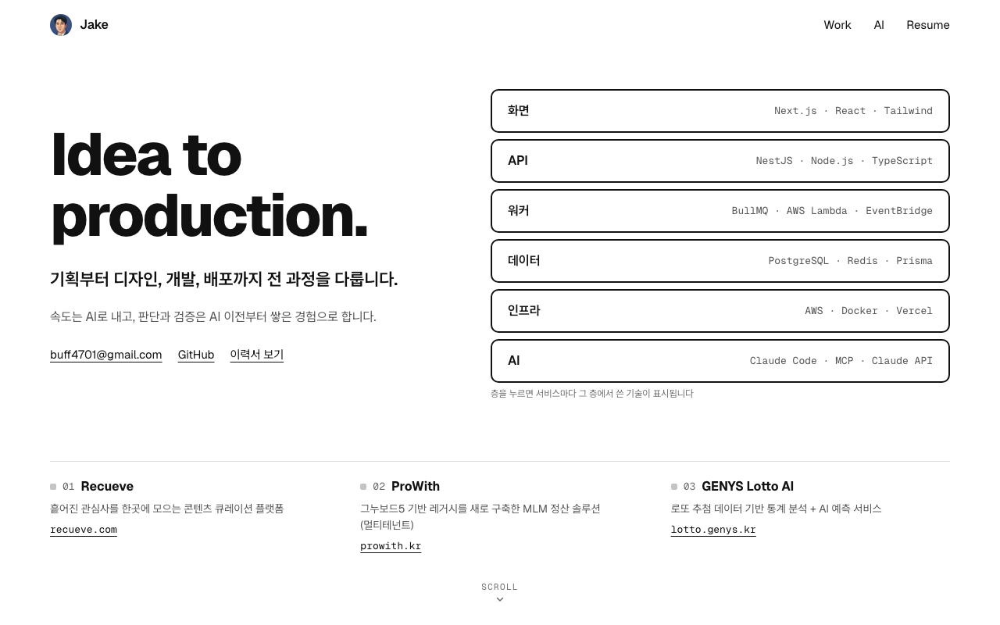 | 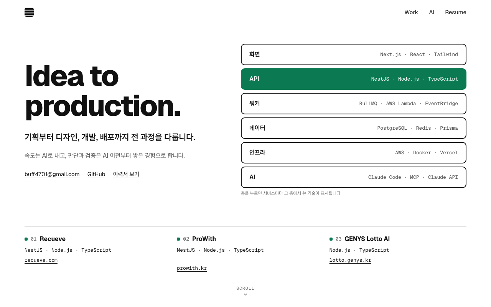 | 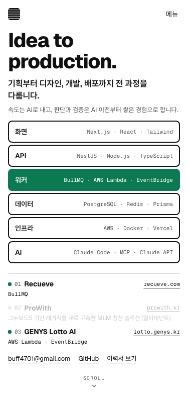 |

### 2. 운영 중인 서비스

| 항목 | 내용 |
|---|---|
| 메시지 | 세 서비스 모두 지금 열어 보실 수 있습니다 |
| 사실과 출처 | 포트폴리오 "1. 한눈에 보기", "4. 프로젝트 상세". 카드 문구는 `content/site/projects/`에 두고 출처 문장을 함께 적습니다 |
| 구성 | 머리 `WORK` · 제목 "운영 중인 서비스" · 소개 "지금 열어 보실 수 있는 서비스 세 개입니다." · 카드 세 장 · 끝에 "포트폴리오 전체 보기"(`/work`) |
| 움직임 | 없음 |

카드에는 실제 화면, 번호와 이름, 제목 문장, 역할과 기간, 확인할 수 있는 숫자 하나, "서비스 열기"와 "자세히 보기"를 담습니다. 설명과 스택, 큰 화면은 `/work`에서 보여 줍니다.

| 카드 | 제목 문장 | 숫자 | 화면 |
|---|---|---|---|
| 01 Recueve | 흩어진 관심사를 한곳에 모읍니다. | URL → 설명 · 카테고리 (붙여넣으면 AI가 레코를 채웁니다) | 로그아웃 상태의 첫 화면(2026-10-19). `/work` 챕터는 로그아웃 상태의 레코 상세(AI가 채운 설명과 카테고리)이고, 다른 사람 얼굴이 든 썸네일은 잘라 냅니다 |
| 02 ProWith | 업체마다 다른 보상 규칙을 하나의 정산 엔진으로 돌립니다. | 설정값 281개 (21개 카테고리 · 관리자 화면에서 바로 반영) | 데모 관리자 대시보드(2026-10-19). 사이드바를 접고 시스템 설정 메뉴를 띄워, 파이 차트까지 들어가게 1920×1200으로 찍습니다. 회원 이름이 나오는 최근 가입 회원 목록은 틀 밖에 둡니다. `/work` 챕터는 운영 설정의 시스템 기본 탭입니다(2026-10-21, 사이드바를 접고 1280×800, 로고가 보여 서비스를 알아볼 수 있음). 버튼은 "데모 열기"입니다 |
| 03 GENYS Lotto AI | 역대 추첨 데이터로 통계 분석과 AI 예측을 함께 합니다. | 966ms → 31ms (분석 API 응답) | 로그인 없이 열리는 스마트 분석(`/work` 챕터도 같음) |

### 3. AI로 일하는 방식

| 항목 | 내용 |
|---|---|
| 메시지 | 구현은 AI를 활용해 빠르게 하고, 기준은 장치로 고정합니다. 개발 밖의 일에도 같은 방식을 씁니다 |
| 사실과 출처 | `content/site/ai/`의 사이트 전용 글. "이 사이트" 카드는 이 저장소 |
| 구성 | 머리 `AI` · 제목 "AI로 일하는 방식" · 소개(메시지와 같음) · 카드 네 장. "자세히 보기"는 `/ai#slug` |
| 움직임 | 없음 |

| 카드 | 제목 문장 | 숫자 | 그림 |
|---|---|---|---|
| Jake Wiki | 자료를 넣으면 AI가 정리하는 위키를 씁니다. | 자료 → 요약 · 교차참조 → 위키 (정리 방식). 이제 막 쌓기 시작한 개인 위키라 숫자는 쓰지 않습니다 | 흐름 도식(raw·clippings → Claude → wiki). 개인 위키라 내용과 화면은 싣지 않습니다 |
| 영상 제작 | 편집 도구를 배우지 않고도 영상을 만듭니다. | 71.9초 · 6장면 · 1080p | 유튜브 썸네일. computer use로 에이전트가 CapCut을 조작했고, 저는 목소리와 음악을 고르고 결과를 판단했습니다. 라이선스 때문에 음악을 바꾼 판단을 한 줄 넣습니다 |
| Jake Hermes | 텔레그램으로 일을 맡기는 개인 비서를 씁니다. | 로컬 모델 · 텔레그램 (내 컴퓨터에서 실행) | 흐름 도식(텔레그램 ⇄ Hermes Agent ⇄ 로컬 모델, 예약 작업). 어떻게 만들었고 어떻게 쓸 수 있는지만 씁니다. 지금 맡긴 일, 예약 작업의 이름과 대상, 개수는 싣지 않습니다 |
| 이 사이트 | 이 사이트도 같은 방식으로 만들었습니다. | ADR 수 · CI 검사 수 (빌드할 때 저장소에서 셉니다) | 다섯 단계(기획 문서, 결정, 구현, 검사, 기록). 검사만 강조색입니다 |

"하네스 엔지니어링"이라는 말은 첫 화면에서 빼고 "이 사이트" 카드에서 씁니다. AI가 지켜야 할 기준을 훅, 검사, CI 같은 장치로 고정하는 일이라고 풀어 씁니다.

### 4. About

| 항목 | 내용 |
|---|---|
| 메시지 | 누가 만들었는지 짧게 |
| 사실과 출처 | 이력서 자기소개(한 줄 소개, 대표이사 겸 연구소장, 정부 기술개발 과제 총괄책임자와 사업화), 포트폴리오 "5. 협업 - 동료 평가" |
| 문구 초안 | 제목 "안녕하세요, 소재희입니다." · 소개 "AI를 더해 기술을 비즈니스 가치로 연결하는 풀스택 개발자입니다. 기술연구소 연구원으로 시작해 증권사 대상 솔루션 회사를 대표이사 겸 연구소장으로 이끌었고, 정부 기술개발 과제를 총괄책임자로 맡아 사업화까지 이뤘습니다. 지금은 기획부터 배포까지 전 과정에 AI 에이전트를 씁니다. 다양한 개발 경험으로 무엇을 어떻게 만들지 정하고, 결과가 맞는지 확인합니다." · 팀 프로젝트 동료 평가 세 문장 · "이력서 보기", 이메일, GitHub |
| 움직임 | 없음 |

연도와 과제 번호는 넣지 않습니다. 사진은 넣지 않습니다. 첫 화면이 글자와 도형만으로 된 구성이기 때문입니다.

**팀 프로젝트 동료 평가** (2026-10-17)

- 기술 스택은 누구나 비슷하게 적지만, 동료 평가는 다른 사람이 쓴 글이라 차별점이 됩니다. 그래서 인용 한 문장을 세 문장으로 늘렸습니다. 홈 구성은 그대로 두고 About 안에서 늘립니다.
- 팀 프로젝트마다 한 문장이고, 서로 다른 면을 보입니다.
  - DocThru · 팀장 · 백엔드: "나이와 경력, 실력에 상관없이 늘 누구에게나 일관성있게 겸손히 소통하시는 모습이 멋있었습니다." (리드와 태도)
  - view My Startup · 풀스택: "기능에 대해 대충 넘어가지 않고 왜 필요하고 어떻게 사용될지 깊이 생각하는 부분에서 시너지가 났고, …" (왜를 묻는 설계)
  - Fitmate · 백엔드: "거의 매일 출석하셔서 백엔드 개발을 꾸준히 해주시고, 프론트엔드 분들과도 소통을 자주 해서 필요한 것들을 반영하고 만들어 주셨습니다." (다른 파트와의 협업)
- 원문 문장은 고쳐 쓰지 않고 잘라서만 씁니다. 문장 중간에서 끊으면 끝에 …를 붙입니다(view My Startup). 문장 하나를 통째로 쓰고 뒤 문장을 뺄 때는 붙이지 않습니다. DocThru의 원문 앞 "팀장으로서"는 출처 줄의 역할과 겹쳐 뺐습니다. 출처에는 기간을 쓰지 않고 프로젝트와 역할만 씁니다.
- 출처는 이력서에서 그 프로젝트의 Peer Review 상자로 가는 링크입니다(`/resume#peer-review-docthru` 등). 상자가 화면 위 1rem에 멈춥니다.

### 5. 푸터

"© 2026 소재희" 한 줄만 둡니다. 연락 방법은 첫 화면과 바로 위 About에 있으므로 반복하지 않습니다. 처음에 둔 "이 사이트의 소스"는 뺐습니다(2026-10-17). 이 사이트의 저장소는 `/ai`의 "이 사이트" 항목에서 엽니다.

### 홈 시안

Design 캔버스에 실제 문구와 화면 캡처로 그린 홈 시안입니다.

| 데스크톱 | 모바일 |
|---|---|
| 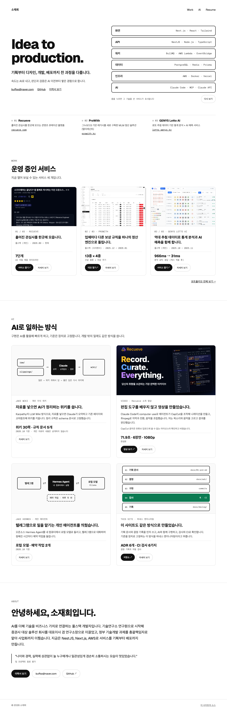 | 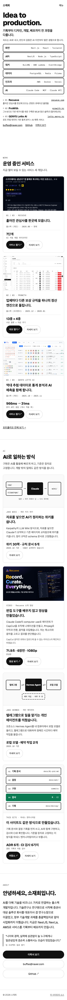 |

## 다른 페이지

### `/work` 포트폴리오 (F2)

| 항목 | 내용 |
|---|---|
| 메시지 | 세 서비스를 어떻게 만들었는지 자세히, 그리고 의뢰받아 만든 사이트 |
| 사실과 출처 | 서비스 챕터는 포트폴리오 원문을 문장을 다시 쓰지 않고 그대로 그립니다(아래 표). 페이지 머리 글과 챕터 구성은 `content/site/work.md`, 사이트 두 개는 `content/site/sites/`의 사이트 전용 글입니다 |
| 구성 | 한 페이지. 머리 → 목차 → 서비스 챕터 01~03 → 의뢰받아 만든 사이트 → 푸터 |
| 움직임 | 없음 |

**머리와 목차**

- 머리 `WORK` · 제목 "포트폴리오" · 소개 "직접 설계·개발·배포한 서비스 세 개입니다. 세 곳 모두 지금 열어보실 수 있습니다."(포트폴리오 "1. 한눈에 보기") 뒤에 "의뢰받아 만든 사이트 두 개도 함께 싣습니다."(사이트 전용)
- 브라우저 제목은 "포트폴리오 · 소재희", 설명은 포트폴리오 "1. 한눈에 보기"의 위 문장입니다.
- 목차는 네 항목(서비스 01~03, 의뢰받아 만든 사이트)이고 화면에 고정하지 않습니다.

**서비스 챕터**

챕터의 id는 서비스 slug(`recueve`, `prowith`, `lotto-ai`)입니다. 홈 카드의 "자세히 보기"가 이곳을 가리킵니다.

| 챕터 | 본문 | 이어지는 AI 절 | 보시는 방법 |
|---|---|---|---|
| 01 Recueve | "4-1" | "3. AI 활용 - 제품" | "보시는 방법"의 Recueve 줄 |
| 02 ProWith | "4-2" | "2. AI 활용 - 개발"의 앞부분("개발 외의 일" 전까지) | ProWith 줄 |
| 03 GENYS Lotto AI | "4-3" | 없음 | GENYS Lotto AI 줄 |

- **머리**: 원문 절의 첫 네 줄(제목, 기간·역할·주소, 스택, 인용 한 줄)을 읽어 그립니다. 여기에 머리글 "01 / 03 · RECUEVE", "서비스 열기"(ProWith는 "데모 열기"), "보시는 방법"(표의 안내에서 주소 줄을 뺀 문장), 기능이 보이는 화면 캡처를 더합니다. 캡처는 홈 카드와 다를 수 있습니다(홈 2의 화면 열). 원문 형식이 바뀌면 읽기가 실패해 빌드가 멈춥니다.
  - ProWith의 인용 한 줄(레거시 전환)은 `work.md`의 replace로 홈 서비스 목록의 소개와 같은 문장("보상플랜과 쇼핑몰을 설정으로 켜고 끄는 MLM 정산 솔루션")으로 바꿉니다(2026-10-16). 강점인 설정과 쇼핑몰이 먼저 보이게 하기 위해서입니다. `/resume`은 원본 그대로입니다.
- **배치**: 데스크톱은 머리를 두 칸(글 왼쪽, 캡처 오른쪽)으로 둡니다. 세로로 긴 Recueve 캡처도 같은 틀에 들어갑니다. 모바일은 위아래로 쌓습니다.
- **본문**: 프로젝트 본문 다음에 AI 절을 둡니다. 2절의 "수당 최대 13종 × 마감 최대 4종"은 4-2의 정산 엔진을 읽은 뒤에 이해되고, 4-1이 AI 절을 뒤쪽으로 가리키기 때문입니다. 소제목은 원문 제목에서 번호만 뺍니다(예: "AI 활용 - 제품"). 긴 본문도 접지 않고 모두 펼칩니다.
- **사이트에서만 고치는 곳**: 원문의 절 순서(2 → 3 → 4)와 챕터 순서가 달라 맞지 않는 곳을 `content/site/work.md`의 구성에서 고칩니다. `content/synced/`는 그대로 둡니다. 대상 문장이 원문에서 사라지면 테스트가 실패합니다.
  - 3절 첫 문단("앞의 하네스가 …")을 뺍니다. Recueve 챕터 앞에는 하네스가 없습니다.
  - 4-1의 "3절 참조"를 "아래 AI 활용 - 제품 참조"로 바꿉니다.
  - 포트폴리오 이미지 두 장과 그 설명 줄을 뺍니다(아래).
- **이미지**: 포트폴리오의 이미지 두 장(ProWith 조직도 미니맵, GENYS Lotto AI 계정 전환기)은 싣지 않습니다. 조직도에는 시드 회원의 이름과 아이디가 읽히고, 계정 전환기에는 공개 연락처가 아닌 이메일이 보입니다. 민감정보 검사는 글자만 읽기 때문에 이미지는 눈으로 확인합니다. 가린 버전이 생기면 다시 봅니다([todo 07](todo/20261015_07_todo_portfolio_images.md)).
- Recueve는 소스 저장소 링크나 코드를 싣지 않습니다.

**의뢰받아 만든 사이트**

머리 `SITES` · 제목 "의뢰받아 만든 사이트" · 소개 "회사 소개 사이트 두 곳을 의뢰받아 만들었습니다. 두 사이트 모두 소스를 공개 저장소에 두었습니다." · 카드 두 장(데스크톱 두 칸, 모바일 한 칸)

카드에는 첫 화면 캡처, 도메인, 이름, 한 줄 설명, 역할과 기간, 스택, "사이트 열기"와 "소스 보기"를 담습니다.

| 카드 | 한 줄 설명 | 역할과 기간 | 스택 |
|---|---|---|---|
| Brain House (brainhouse.kr) | AI·ICT 컨설팅 회사의 소개 사이트입니다. 한국어, 영어, 일본어로 볼 수 있고, Three.js로 만든 3D 요소와 문의 메일 발송을 넣었습니다. | 외부 의뢰 · 2025.12 ~ 2026.02 · 커밋 74개 | Next.js 14 · TypeScript · Tailwind CSS · Three.js · Resend |
| AI TOOLS (aitoolz.kr) | AI 광고 성과 분석 솔루션을 소개하고 데모 신청과 문의를 받는 B2B 사이트입니다. 9개 페이지를 기획서에서 배포까지 혼자 만들었습니다. | 외부 의뢰 · 2026.06 · 구현 커밋 46개 · 첫 커밋부터 23시간 | Next.js 16 · React 19 · Tailwind CSS 4 · Motion · Resend · Vitest · Playwright |

- AI TOOLS 카드에는 저장소 README의 작업 흐름을 한 줄 더합니다. "Claude Code를 활용해 기획서를 명세(SPEC.md), 계획, 태스크 문서로 옮기고, 태스크마다 타입 검사와 린트, 테스트를 통과시키며 구현했습니다." 그 아래에 "기획서 → SPEC.md → plan.md → todo.md → 구현·검증"을 적습니다.
- 사실은 공개 저장소의 README, 커밋 기록, `package.json`과 라이브 페이지에서만 가져옵니다. 역할은 "외부 의뢰"로 씁니다.
- 걸린 시간은 공개 저장소의 커밋 기록처럼 확인할 수 있는 근거로 씁니다. 기간은 첫 커밋과 마지막 커밋이 아니라 커밋 날짜 분포를 보고 구현 커밋이 몰린 기간으로 씁니다. AI TOOLS의 2026-09 커밋 하나는 README 정리라 기간과 개수에서 뺍니다.
- 캡처는 한국어 첫 화면(1280×800)입니다. 두 사이트의 푸터와 회사 정보에 있는 이메일, 대표자, 사업자번호는 화면에도 글에도 옮기지 않습니다.

### 포트폴리오 시안

Design 캔버스에 실제 문구와 화면 캡처로 그린 `/work` 시안입니다. 아트보드 높이 제한 때문에 02 ProWith와 03 GENYS Lotto AI 챕터는 앞부분만 그리고 나머지는 점선 줄("원문 이어짐")로 줄였습니다. 실제 페이지에서는 모두 펼칩니다.

| 데스크톱 | 모바일 |
|---|---|
| 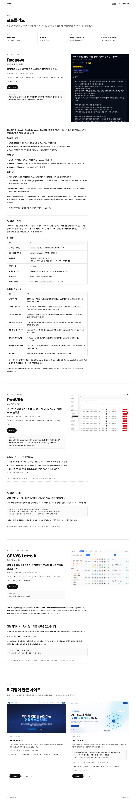 | 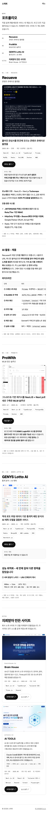 |

### `/ai` AI로 일하는 방식 (F3)

| 항목 | 내용 |
|---|---|
| 메시지 | AI를 활용해 만든 것과 일하는 방식 |
| 사실과 출처 | `content/site/ai/`의 사이트 전용 글. 포트폴리오에 있는 항목(코드 리뷰 스킬, 이미지 MCP, 영상 제작, ProWith 운영 하네스, Recueve AI 자동 채움)은 포트폴리오 "2", "3"의 사실만 씁니다 |
| 구성 | 한 페이지. 머리 → 목차 → 네 묶음 → 푸터. 항목의 id는 slug이고 홈 AI 카드의 "자세히 보기"가 `/ai#slug`로 옵니다 |
| 움직임 | 없음 |

**머리와 목차**

- 머리 `AI` · 제목 "AI로 일하는 방식" · 소개 "구현은 AI를 활용해 빠르게 하고, 기준은 장치로 고정합니다. 개발 밖의 일에도 같은 방식을 씁니다."(홈 섹션과 같음)
- 브라우저 제목은 "AI로 일하는 방식 · 소재희"입니다.
- 목차는 묶음 네 칸이고, 칸마다 항목 링크를 둡니다. 화면에 고정하지 않습니다.
- **사례 입구**(2026-10-20): 머리 소개 아래, 목차 위에 AI 도구 활용 사례(`/ai/case`)로 가는 띠를 둡니다. 왼쪽에 머리글 "CASE · ProWith · MLM 정산 솔루션", 제목 "AI 도구 활용 사례", 버튼 "자세히 보기 →"를 두고, 오른쪽에 4컷 작은 그림을 한 줄로 둡니다. 모바일은 그림 줄이 버튼 아래로 갑니다. 띠 전체가 링크입니다.
  - 버튼은 처음에 "한눈에 보기"였지만 "자세히 보기"로 바꿨습니다(2026-10-20). 누르면 가는 곳은 4컷과 본문 여섯 문단이 있는 긴 페이지이고, 한눈에 보는 일은 띠의 작은 그림이 이미 합니다. 사이트에서 상세로 보내는 다른 버튼(홈 AI 카드, 짧은 카드)도 "자세히 보기"입니다.
  - 사례 전체를 `/ai` 맨 위에 펼치면 묶음까지 스크롤이 한참 길어져 입구만 둡니다. 한 줄 링크(눈에 덜 띔)와 2×2 작은 카드도 비교했습니다([AI 사례 시안](#ai-사례-시안)).

**묶음과 항목**

| 묶음 | 항목 (slug) | 형식 |
|---|---|---|
| 개발 방식 | 이 사이트(`this-site`), 작업 환경(`workbench`), 코드 리뷰 스킬(`code-review`), ProWith 운영 하네스(`prowith-harness`) | 앞의 셋은 상세, 하네스는 짧은 카드 |
| 제품에 넣은 AI | Recueve AI 자동 채움(`recueve-autofill`) | 짧은 카드 |
| 개발 밖의 일 | 영상 제작(`video`), 이미지 MCP(`image-mcp`) | 상세 |
| 개인 도구 | Jake Wiki(`jake-wiki`), Jake Hermes(`jake-hermes`) | 상세 |

- **상세**: 머리글과 제목 문장(홈 카드와 같음), 그림, 문제 · 만든 것 · 결과 세 단락, 숫자 하나, 링크입니다. 데스크톱은 글 왼쪽, 그림 오른쪽 두 칸이고 모바일은 이름 다음에 그림을 둡니다.
  - Jake Wiki와 Jake Hermes는 "결과" 대신 "쓰는 법"을 씁니다. 위키는 이제 막 쌓기 시작해 숫자를 쓰지 않습니다. Hermes는 어떻게 만들었고 어떻게 쓸 수 있는지만 쓰고, 지금 맡긴 일은 쓰지 않습니다.
  - 그림은 홈 카드의 도식과 썸네일을 그대로 쓰고, 코드 리뷰 스킬(PR → 리뷰어 여섯 → 점수)과 이미지 MCP(Claude Code ⇄ MCP 서버 ⇄ Gemini 이미지 모델) 도식을 새로 그립니다.
  - 작업 환경은 홈 카드가 없어 도식(휴대폰 ⇄ Orca ⇄ Aside, 아래에 VS Code와 Antigravity CLI)을 새로 그립니다. 도구 화면을 캡처하면 다른 프로젝트 이름이 보여서 캡처는 쓰지 않습니다.
  - 작업 환경은 쓰는 도구와 그 도구로 하는 일만 씁니다. 다른 제품과의 비교는 확인할 근거가 없어 쓰지 않습니다.
- **짧은 카드**: 원문이 `/work`에 있는 두 항목입니다. 문제 · 만든 것 · 결과를 한 줄씩과 숫자 하나를 두고, "자세히 보기"는 `/work`의 AI 절로 갑니다(`/work#prowith-ai`, `/work#recueve-ai`). 같은 글을 두 페이지에 싣지 않습니다.
- **근거 링크**
  - 코드 리뷰 스킬: 이 저장소 PR의 리뷰 코멘트
  - 이 사이트: 저장소, ADR 목록, 작업 일지
  - 작업 환경: Orca 저장소, Aside, Antigravity 사이트
  - 영상 제작: 유튜브
  - Jake Hermes: 오픈소스 Hermes Agent 저장소
  - Jake Wiki, 이미지 MCP: 링크 없음. 개인 자료이거나 비공개 저장소라 만든 방법만 씁니다
- 이미지 MCP는 오픈소스 서버(gemini-imagen-mcp-server, MIT)를 바탕으로 만들었다고 정확히 씁니다.

### AI 시안

Design 캔버스에 실제 문구로 그린 `/ai` 시안입니다.

| 데스크톱 | 모바일 |
|---|---|
| 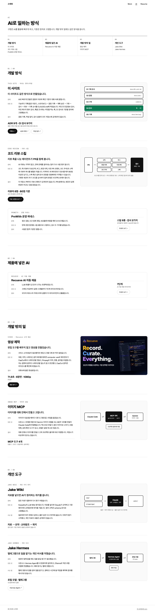 | 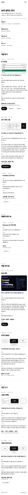 |

작업 환경 항목은 시안 뒤에 더해서, 기존 항목의 틀로 구현한 화면을 캡처했습니다(2026-10-16).

| 데스크톱 | 모바일 |
|---|---|
| 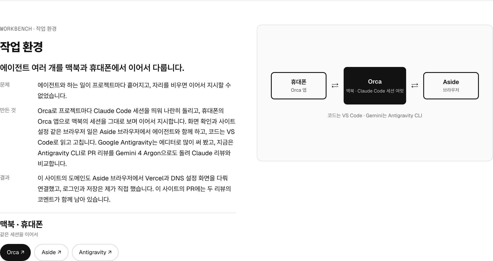 | 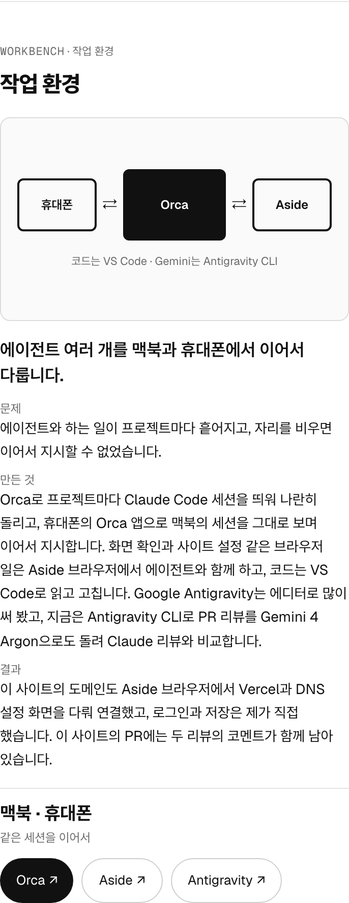 |

### `/ai/case` AI 도구 활용 사례

1차를 배포한 뒤 더한 페이지입니다(2026-10-20).

| 항목 | 내용 |
|---|---|
| 메시지 | 프로젝트 하나를 셋업부터 사양 정리, 검증, 기록까지 AI와 진행한 흐름. 구현은 AI로 빨라졌고, 애매한 규칙을 정하고 검증 결과로 반영을 판단하는 일은 제가 합니다 |
| 사실과 출처 | 커리어 저장소 `AI활용사례/`의 본문(txt), 제목과 4컷 설명(json), 4컷 그림(png)을 동기화로 가져옵니다([ADR-0003](adr/0003-content-source-and-sync.md#원본-추가-ai-도구-활용-사례-2026-10-20)). 문장은 고치지 않고 그대로 그립니다 |
| 구성 | 한 페이지. 돌아가기 링크 → 머리 → 4컷 → 본문 → 끝 링크 → 푸터. 원본 PDF와 같은 순서입니다 |
| 움직임 | 없음 |

- **왜 따로 두나**: 이 사례는 ProWith 한 항목이 아니라, 프로젝트 하나로 일하는 방식 전체를 보여 주는 예시입니다. 4컷과 본문 여섯 문단이 `/ai`의 다른 항목보다 길어, `/ai` 안에 펼치지 않고 따로 둡니다. F3 기획에서 정한 "항목별 페이지(`/ai/[slug]`)는 만들지 않는다"의 예외입니다. 짧은 카드가 아니라 긴 사례 글이기 때문입니다.
  - 팝업도 비교했습니다. 주소가 없어 링크로 보낼 수 없고, 긴 글을 팝업 안에서 다시 스크롤해야 하고, 뒤로 가기를 따로 맞춰야 해서 페이지로 정했습니다.
- **메뉴**: 헤더 메뉴에는 더하지 않습니다. 사례가 하나뿐인 메뉴는 비어 보입니다(블로그를 하지 않는 이유와 같습니다). 사례가 두세 개로 늘면 다시 봅니다.
  - 이 페이지에서도 헤더의 "AI"에 지금 보는 곳 표시(밑줄)를 붙입니다(아래 공통 요소).
- **돌아가기 링크**: 머리 위에 "← AI로 일하는 방식"(`/ai`)을 둡니다.
- **머리**: 머리글 `AI / CASE` · 제목 "AI 도구 활용 사례"(json 제목) · 부제 "ProWith · MLM 정산 솔루션"(json 부제에서 작성자 이름을 뺀 것)
  - 브라우저 제목은 "AI 도구 활용 사례 · 소재희"입니다. 검색 설명은 본문 마지막 문단의 첫 문장입니다.
- **4컷**: 데스크톱은 2×2, 모바일은 한 칸씩 크게 쌓습니다. 칸마다 그림 아래에 번호(강조색 원)와 설명(json의 4컷 설명)을 둡니다.
  - 설명은 그림의 캡션(`figcaption`)으로 묶습니다. 그림이 담은 내용을 설명이 그대로 말하므로 화면 읽기 프로그램은 설명을 읽습니다.
  - 가로 한 줄(네 칸)과 그림 옆에 설명을 두는 배치도 비교했습니다. PDF와 같은 모양이고 모바일에서 그림이 가장 크게 보이는 2×2로 정했습니다.
- **본문**: 소제목 "어떻게 만들고 검증했나"(json 본문 제목)와 txt의 문단입니다. 글 폭은 읽기 좋게 좁힙니다.
- **끝 링크**: "포트폴리오 원문 보기"(`/work#prowith-ai`)와 "AI로 일하는 방식"(`/ai`)입니다. 같은 하네스의 스킬 표와 검사 설명은 `/work` 원문에 있습니다.
- `/ai`의 ProWith 운영 하네스 짧은 카드는 그대로 둡니다. 스킬 6종을 요약하고 `/work` 원문으로 보내는 역할이 다릅니다.
- 맨 위로 버튼은 두지 않습니다. 목차가 없고 길이가 화면 세 개 남짓입니다.
- 검색과 공유: 대표 주소, 공유 정보, 사이트맵을 다른 페이지와 같은 기준으로 둡니다. 공유 그림은 공통 그림 한 장입니다([검색과 공유 정책](guide/SEO_검색과_공유_정책_20261017.md)).

### AI 사례 시안

개발 서버의 `/ai`에 시안 CSS와 마크업을 얹어 1280과 375 폭으로 찍어 골랐습니다. 입구 세 안과 4컷 배치 세 안을 비교한 판과, 다크 모드 세 안을 비교한 판을 남깁니다. 다크 모드에서도 그림은 그대로 둡니다. 아래 여덟 장은 구현한 화면입니다(2026-10-20).

| 입구 1280 | 입구 375 | 입구 1280 다크 | 입구 375 다크 |
|---|---|---|---|
| 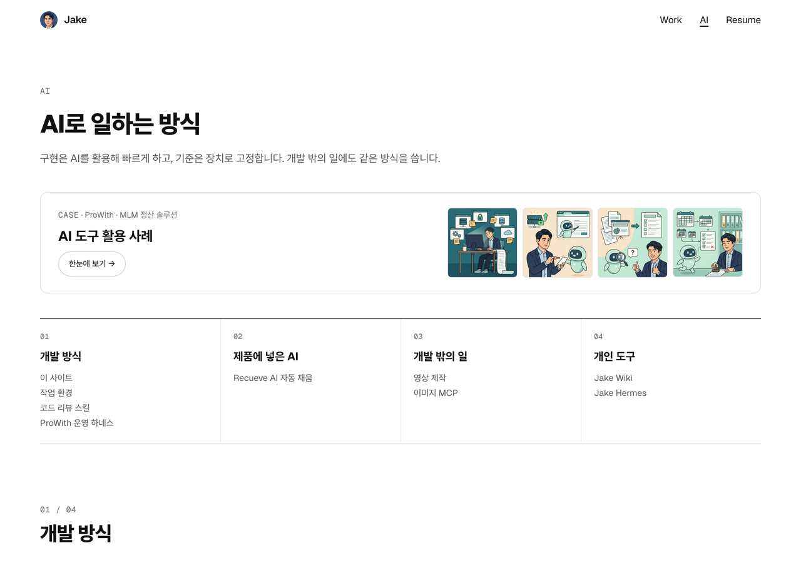 | 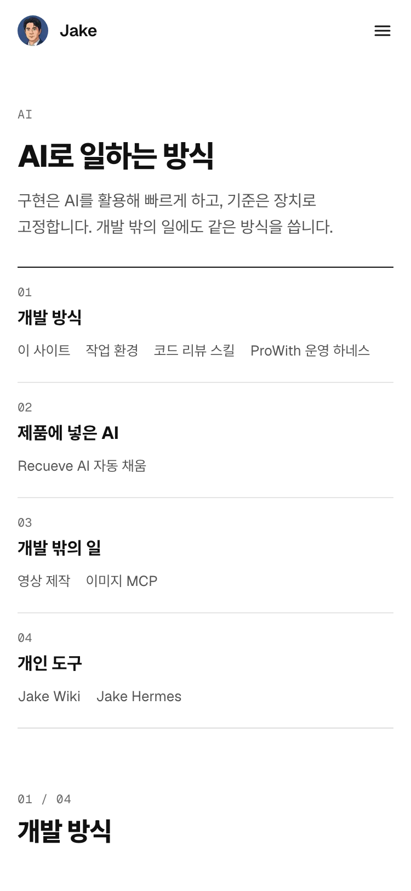 | 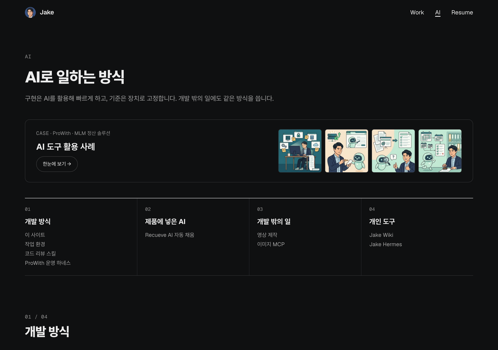 | 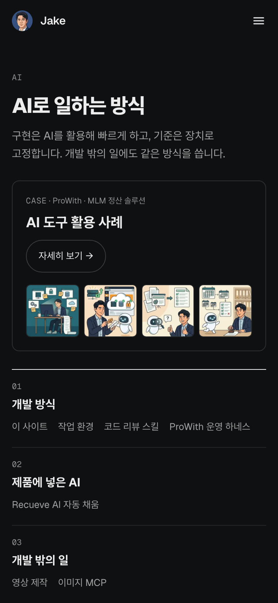 |

| 사례 1280 | 사례 375 | 사례 1280 다크 | 사례 375 다크 |
|---|---|---|---|
| 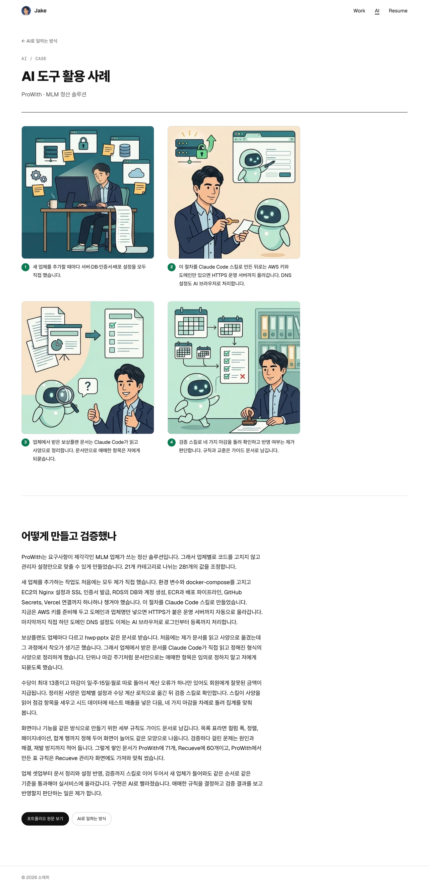 | 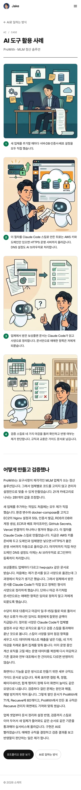 | 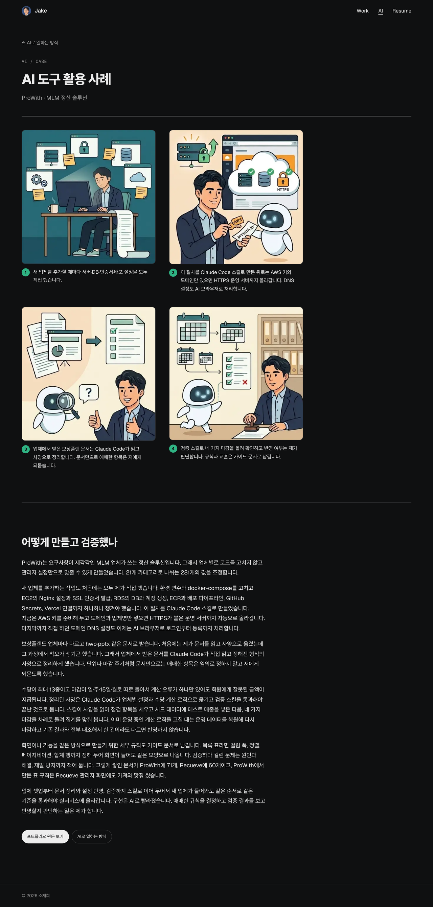 | 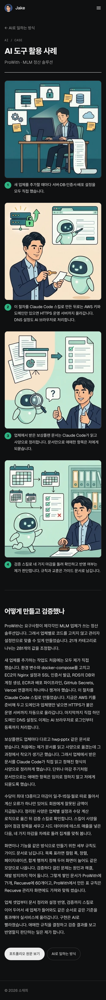 |

| 입구와 4컷 배치 비교판 | 다크 모드 비교판 |
|---|---|
| 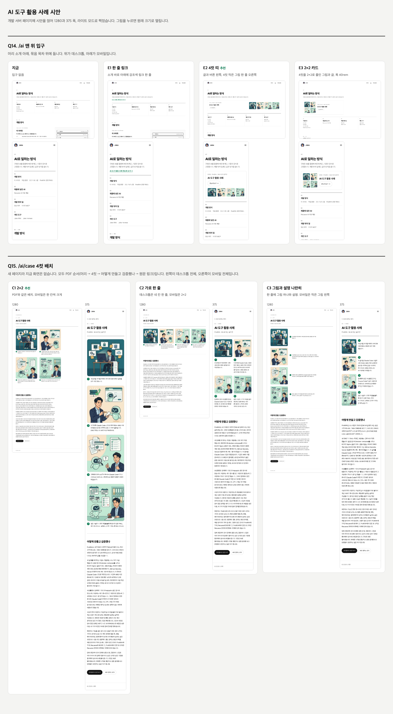 | 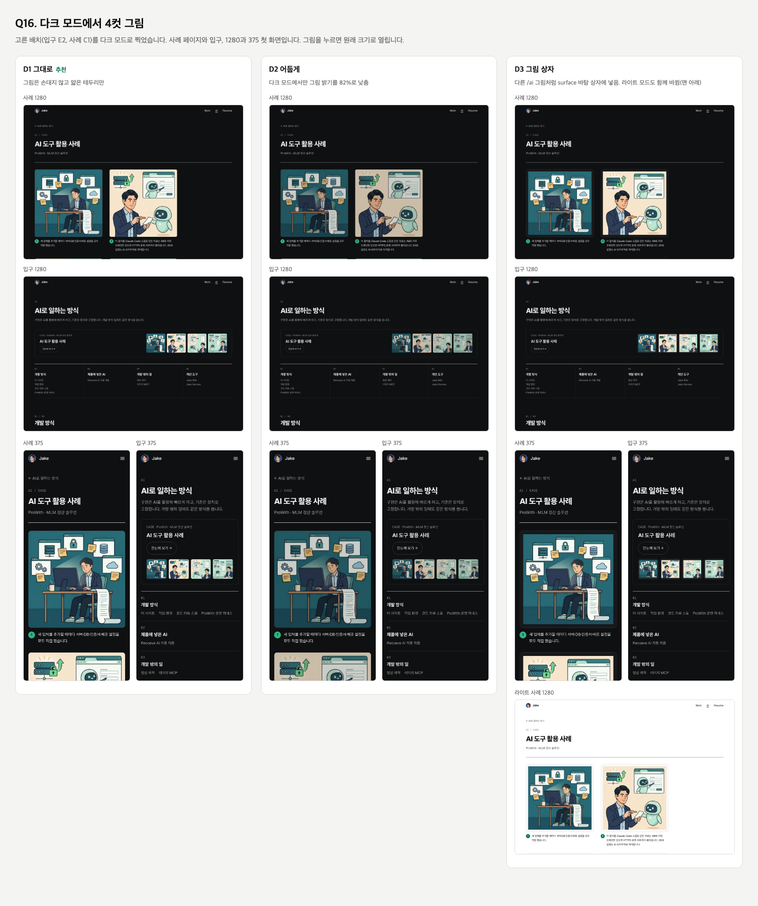 |

### `/resume` 이력서 (F4)

| 항목 | 내용 |
|---|---|
| 메시지 | 이력서 원본과 같은 내용을 웹과 인쇄로 |
| 사실과 출처 | `content/synced/resume.md` 전체(동기화에서 빠진 항목은 [ADR-0003](adr/0003-content-source-and-sync.md#구현-원칙)) |
| 구성 | 이력서 순서 그대로. 머리 → 목차 → 원문 열 절 → 끝 사진 → 푸터. 인쇄하면 A4 단위로 깔끔하게 나옵니다 |
| 움직임 | 없음 |

**머리와 목차**

- 머리 `RESUME` 아래에 원문의 첫 두 줄(한 줄 소개, 이름)을 그대로 둡니다. 이름이 페이지의 h1입니다. 오른쪽(모바일은 아래)에 "인쇄 · PDF로 저장" 버튼을 둡니다.
- 브라우저 제목은 "이력서 · 소재희", 설명은 자기소개의 "AI를 더해 기술을 비즈니스 가치로 연결하는 풀스택 개발자"입니다.
- 목차는 원문의 절(h2) 열 개입니다. 데스크톱은 다섯 칸 두 줄, 모바일은 두 칸 다섯 줄이고 화면에 고정하지 않습니다.
- 절의 id는 영어로 고정합니다: `contact`, `about`, `skills`, `education`, `experience`, `projects`, `training`, `awards`, `talks`, `certificates`. 원문의 절이 바뀌어 목록과 맞지 않으면 빌드와 테스트가 멈춥니다.

**본문**

- 원문을 F2의 마크다운 컴포넌트([ADR-0009](adr/0009-markdown-renderer.md))로 그대로 그립니다. 사이트에서 문장을 고치거나 빼는 규칙을 두지 않습니다. 고칠 것은 원본에서 고치고 동기화로 가져옵니다.
- 원문의 줄바꿈을 살립니다. 강점 다섯 줄과 동료 평가 인용이 한 문단으로 붙지 않게 하기 위해서입니다. `/work`는 지금처럼 둡니다.
- 경력과 프로젝트 제목(h3) 바로 아래의 직함과 기간 줄은 흐린 글자로 씁니다.
- 원문의 구분선(`---`)을 절과 항목 사이의 선으로 씁니다.
- 640px 미만 화면에서 연락처와 학력 표는 행마다 상자 하나로 그리고, 칸마다 왼쪽에 열 머리글 이름표, 오른쪽에 값을 둡니다(2026-10-17, [모바일 표](guide/UI_모바일_표_20261017.md) 가이드).
  - 대상은 네 칸 이상이거나 본문 행이 하나뿐인 표입니다. 수상 표(여러 행, 세 칸)는 화면 안에 들어가 표로 둡니다.
  - 처음에는 두 표를 상자 안에서 가로로 넘겼습니다. 칸 안의 주소를 끊지 않아([03-design.md](03-design.md) 표 칸) 연락처(`홈페이지` 열이 생긴 뒤)가, 최소 폭 32.5rem 때문에 학력이 넘쳤습니다.
  - 640px 이상 화면과 인쇄는 표 그대로입니다.
- 원문의 **Peer Review** 머리글과 바로 뒤의 인용은 동료 평가 상자로 묶어 보입니다(2026-10-17). 프로젝트 소개 한 줄도 같은 인용 모양이라, 그대로 두면 동료 평가가 눈에 띄지 않았습니다. 글은 고치지 않고 묶음만 더합니다.
  - 상자마다 id(`peer-review-docthru`, `peer-review-view-my-startup`, `peer-review-fitmate`)가 있고, 홈 About의 동료 평가 세 줄이 각 상자로 보냅니다.
  - 머리글 글자와 상자 id, 상자를 찾을 글은 `content/site/resume-page.md`의 `reviews`에 둡니다. 원문에서 글이 사라지거나 한 글이 두 상자에 걸리면 빌드가 멈춥니다.

**끝 사진** (2026-10-17)

- 마지막 절(자격증) 아래, 푸터 위에 바닷가 그네에 앉아 바다를 보는 뒷모습 사진을 한 장 둡니다. 이력서 문서에 없는 사람의 모습을 끝까지 읽은 사람에게 보여 줍니다.
- 캡션은 달지 않습니다. 장소나 날짜를 적으면 이력서와 포트폴리오에 없는 사실이 되기 때문입니다. 대체 텍스트는 `content/site/resume-page.md`의 `endPhotoAlt`에 둡니다.
- 머리에 증명사진을 두는 안도 만들어 봤지만 넣지 않았습니다. 이 사이트는 작업과 일하는 방식을 보여 주는 곳이라 얼굴 사진이 판단에 보탬이 되지 않습니다. 공개 저장소에 얼굴 사진이 이력으로 남는 것도 피했습니다.

**인쇄**

- 버튼은 브라우저 인쇄(`window.print()`)만 엽니다. PDF 파일은 따로 올리지 않습니다. 원본 저장소에서 만드는 PDF는 공개하지 않습니다.
- A4로 찍습니다. 헤더, 푸터, 머리 `RESUME`, 목차, 버튼은 숨기고 한 줄 소개와 이름부터 찍습니다.
- 다크 모드여도 흰 바탕에 검은 글자로 찍습니다.
- 동료 평가 상자는 바탕 없이 강조색 왼쪽 선만 남깁니다.
- 끝 사진은 찍지 않습니다. 인쇄본은 이력서 문서로만 남깁니다.
- 제목이 페이지 끝에 홀로 남지 않고, 목록 한 줄, 문단, 표의 행이 페이지 사이에서 잘리지 않게 합니다.
- 원문의 링크는 주소가 글자로 적혀 있어 따로 붙이지 않습니다. 링크 뒤의 ↗는 인쇄에서 숨깁니다.

### 이력서 시안

Design 캔버스에 실제 문구로 그린 `/resume` 시안입니다. 화면은 위쪽만, 인쇄는 첫 장만 그렸습니다.

| 데스크톱 | 모바일 | 인쇄 첫 장 (A4) |
|---|---|---|
| 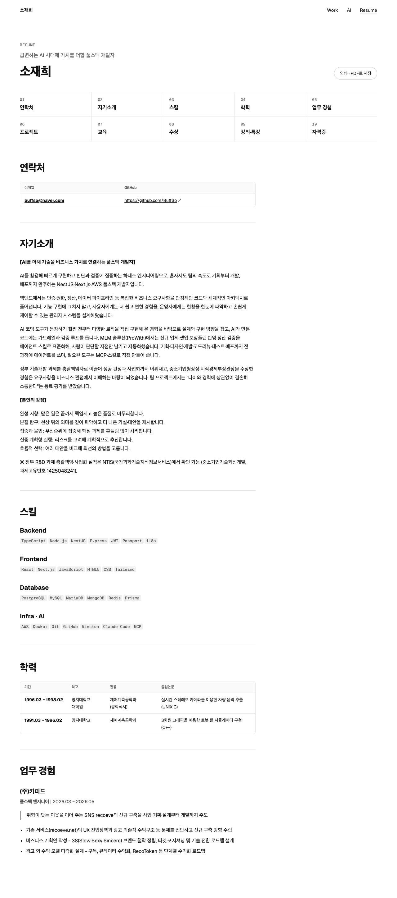 | 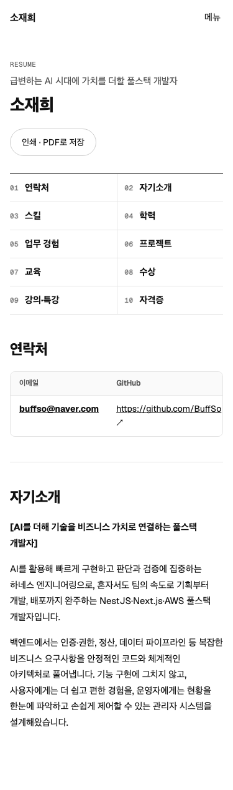 | 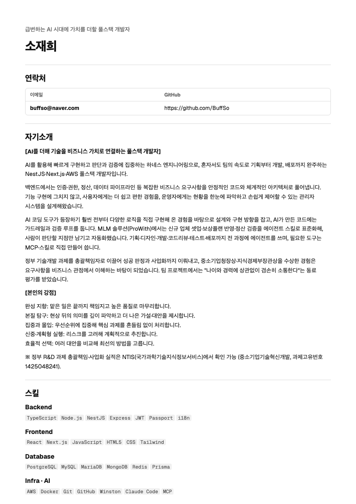 |

## 공통 요소

- **헤더** - 프로필 그림과 별칭 "Jake"(홈), Work(`/work`), AI(`/ai`), Resume(`/resume`). 모바일은 메뉴 아이콘으로 같은 세 항목을 엽니다
  - 모바일 메뉴(2026-10-17): 버튼은 아이콘(☰)이고 열리면 X로 바뀝니다. 화면 읽기 프로그램에는 "메뉴"로 읽힙니다. 처음의 "메뉴" 글자 버튼과 폭 10rem 상자는 썰렁하고 오른쪽이 비어 바꿨습니다
  - 펼치면 헤더 바로 아래에 화면 폭 전체 패널이 열리고, 뒤 페이지는 어둡게 덮입니다. 줄마다 왼쪽에 이름, 오른쪽에 페이지 제목(포트폴리오, AI로 일하는 방식, 이력서)이 있어 영어 이름이 어떤 페이지인지 바로 보입니다
  - 메뉴에는 페이지 이동만 둡니다. 연락처(이메일, GitHub)는 넣지 않습니다. 데스크톱 헤더에도 연락처가 없습니다
  - 메뉴 링크, 메뉴 밖, 어둡게 덮은 곳을 누르거나 Esc, 뒤로 가기를 하면 닫힙니다
  - 홈 링크는 실명 대신 GitHub 프로필 일러스트의 얼굴(원)과 별칭 "Jake"입니다. 실명이 버튼으로 쓰이지 않게 하려는 것이고, 실명은 브라우저 제목, 푸터, About, 이력서에 그대로 둡니다
  - 그림은 장식이라 대체 텍스트를 비우고, 링크 이름은 보이는 글자 "Jake"입니다. 그림 파일은 저장소에 둡니다(`src/assets/jake-avatar.png`)
  - 지금 보는 페이지의 메뉴는 밑줄로 표시하고, 화면 읽기 프로그램에는 `aria-current="page"`로 알립니다(2026-10-17). 홈과 없는 주소에서는 표시하지 않습니다
  - 메뉴 아래의 페이지(`/ai/case`)에서는 그 메뉴(AI)에 같은 밑줄을 붙이고, 화면 읽기 프로그램에는 `aria-current="true"`로 알립니다(2026-10-20). 그 메뉴 안에 있다는 뜻이고, 지금 페이지 자체는 아니기 때문입니다
- **본문으로 건너뛰기** - 키보드로 처음 Tab을 누르면 나타나 헤더를 건너뜁니다
- **맨 위로** - 네 페이지 모두에 둡니다(2026-10-17). 세 페이지의 목차는 화면에 고정하지 않아, 내려가면 목차로 돌아갈 길이 없었습니다. 홈도 화면 5~7개 길이라 같이 둡니다
  - 위쪽의 길잡이가 화면 위로 다 사라지면 보이고, 다시 보이면 숨습니다. 길잡이는 `/work`, `/ai`, `/resume`에서는 목차, 홈에서는 서비스 목록이 든 첫 화면입니다(첫 화면의 서비스 이름이 아래 카드로 가는 목차 역할을 합니다)
  - 누르면 페이지 맨 위로 올라가고 길잡이에 초점을 둡니다. 키보드로 눌러도 바로 목차나 첫 화면의 링크로 이어 갈 수 있고, 버튼이 숨을 때 초점을 잃지 않습니다
  - 부드럽게 올라가고, 움직임 줄이기 설정에서는 바로 올라갑니다. 나타나고 숨을 때는 움직임이 없습니다
  - 스크롤하는 동안은 화면 오른쪽 아래에 붙어 있고, 페이지 끝에서는 푸터 위에 멈춰 푸터 링크를 가리지 않습니다. 이력서 인쇄에서는 숨깁니다
- **푸터** - "© 2026 소재희", "이 사이트의 소스"(이 저장소)
- **탭 아이콘** - 헤더 홈 링크와 같은 일러스트 얼굴(원)입니다(2026-10-17). 그전에는 Next.js 기본 아이콘이었습니다
  - 탭의 아이콘과 페이지의 홈 링크가 같은 얼굴이라 바로 이어집니다. 탭 여러 개 사이에서도 파란 원이 눈에 띕니다
  - 다크 모드에서도 같은 아이콘을 씁니다. 휴대폰 홈 화면 아이콘은 같은 얼굴을 사각형 그대로 둡니다(iOS가 모서리를 깎습니다)
- **질문 창** (2차) - 모든 페이지에서 열 수 있는 패널

## 콘텐츠 흐름

```
비공개 커리어 저장소 (원본 md, AI 도구 활용 사례 txt·json·png)
  │  npm run sync  (허용 목록, 동기화 규칙)
  ▼
content/synced/    ← 동기화 결과. 직접 고치지 않는다. 커밋한다.
content/site/      ← 이 사이트에서만 쓰는 글 (원본에 없는 작업, AI 작업 등)
  │  빌드할 때 파싱
  ▼
페이지
```

`content/synced/`가 커밋돼 있으므로 원본 저장소가 없어도 누구나 빌드할 수 있습니다. 자세한 이유는 [ADR-0003](adr/0003-content-source-and-sync.md)에 있습니다.

## 콘텐츠 모델 (초안)

```ts
type Project = {
  slug: "recueve" | "prowith" | "lotto-ai";
  title: string;
  summary: string;        // 한 줄 설명
  headline: string;       // 홈 카드의 제목 문장
  period: string;         // 예: "2025.10 ~ 2025.11"
  role: string;           // 예: "풀스택 (개인)"
  stack: string[];
  metric: { value: string; label: string };
  liveUrl: string;
  // 상세 본문과 "보시는 방법"은 이 글에 두지 않고 포트폴리오 원문에서 그립니다(/work)
};

type Site = {             // content/site/sites/
  slug: "brainhouse" | "aitools";
  order: number;
  title: string;
  domain: string;         // 예: "brainhouse.kr"
  summary: string;        // 한 줄 설명
  workflow?: string;      // AI TOOLS의 Claude Code 작업 흐름 한 줄
  flow?: string;          // 그 아래의 단계 줄 (기획서 → SPEC.md → …)
  role: string;           // "외부 의뢰"
  period: string;         // 예: "2025.12 ~ 2026.02"
  commits: string;        // 예: "커밋 74개"
  stack: string[];
  liveUrl: string;
  sourceUrl: string;
  imageAlt: string;
};

type WorkPage = {         // content/site/work.md
  label: string;
  title: string;
  intro: string;          // 포트폴리오 "1. 한눈에 보기"의 문장
  introSite: string;
  sites: { label: string; title: string; intro: string };
  chapters: {
    slug: Project["slug"];
    detail: string;       // "4. 프로젝트 상세"의 절 제목 앞부분
    ai?: string;          // 이어 붙일 AI 절
    aiUntil?: string;     // AI 절에서 멈출 제목
    howToView: string;    // "보시는 방법" 표의 서비스 이름
    drop?: string[];      // 이 접두어로 시작하는 줄을 뺀다
    replace?: { find: string; to: string }[];   // 본문, AI 절, 인용 한 줄의 문자열을 바꾼다
  }[];
};

type StackLayer = {
  name: "화면" | "API" | "워커" | "데이터" | "인프라" | "AI";
  items: {                // 최대 네 개, 층 글자는 360 폭에서 한 줄
    name: string;          // scripts/stack.config.mjs의 표지 이름과 같다
    usedBy: Project["slug"][];   // 이 기술을 쓴 서비스. 서비스 코드로 확인한다 (ADR-0010, npm run check:stack)
  }[];
};

type AiWork = {           // content/site/ai/
  slug: string;
  order: number;          // 페이지 안 순서
  group: "dev" | "product" | "beyond" | "personal";
  home?: number;          // 홈 카드 순서 (홈에 싣는 네 항목만)
  eyebrow: string;
  title: string;
  headline: string;       // 홈 카드와 /ai의 제목 문장
  desc?: string;          // 홈 카드 설명
  problem: string;        // 무엇이 문제였나
  built: string;          // 무엇을 만들었나
  result?: string;        // 무엇이 달라졌나 (확인 가능한 근거)
  usage?: string;         // 쓰는 법 (Jake Wiki, Jake Hermes)
  metric: { value: string; label: string };
  links: { label: string; href: string }[];
  more?: string;          // 짧은 카드의 "자세히 보기" (/work#…)
};

type AiCase = {           // content/synced/ (커리어 저장소 AI활용사례/의 json, txt, png)
  title: string;          // "AI 도구 활용 사례"
  subtitle: string;       // "ProWith · MLM 정산 솔루션" (작성자 이름은 동기화 규칙으로 뺀다)
  panels: {
    crop: [number, number, number, number];   // 4컷 그림에서 자를 자리 (x, y, 폭, 높이)
    caption: string;
  }[];
  heading: string;        // "어떻게 만들고 검증했나"
  body: string[];         // txt의 문단
};
```

필드는 1차 구현 때 확정하고 이 문서를 고칩니다.
