# 03. 디자인 원칙

- 상태: F1 구현 반영 (2026-10-15). 강조색은 F1 스토리보드에서, 다크 모드 색과 글자 크기, 컴포넌트 모양은 F1 구현에서 정했습니다. 다음 기능은 아래 "F1에서 정한 값"을 이어 씁니다. `/work`(F2)의 값은 F2 스토리보드에서 정하고 F2 구현에 반영했습니다(아래 "F2에서 정한 값").

## 원칙

1. **1분 원칙** - 첫 화면은 짧은 움직임으로 궁금증을 만든 뒤, 같은 화면 안에서 무엇을 만들었고 어떻게 일하는지가 다 보이게 끝납니다. 사실을 클릭이나 스크롤 뒤에 숨기지 않습니다.
2. **증거가 먼저** - 꾸밈보다 라이브 링크, 실제 화면, 저장소 링크를 앞에 둡니다.
3. **움직임은 절제해서** - 1차에서는 첫 화면에만 움직임을 둡니다. 방향, 금지 목록, 박자는 [04-motion.md](04-motion.md)를 따릅니다. `prefers-reduced-motion`이면 마지막 장면만 보여 줍니다. 소리는 넣지 않습니다.
4. **라이트와 다크** - 시스템 설정을 따릅니다. 두 모드 모두에서 대비 기준을 지킵니다.
5. **모바일 우선** - 좌우 여백 16px, 가로 스크롤 없음.
6. **인쇄** - `/resume`은 인쇄했을 때 A4 한 장 단위로 깔끔하게 나와야 합니다.
7. **단위는 rem** - 손으로 쓰는 길이(글자 크기, 간격, 크기, 화면 너비 기준점)는 rem으로 씁니다. 줄 간격은 단위 없이, 자간은 em으로 씁니다. 브라우저 기본 글자 크기를 키운 사용자에게 화면 전체가 같은 비율로 커지게 하기 위해서입니다. 스토리보드의 px 값은 옮길 때 rem으로 바꿉니다(16px = 1rem).
   - 테두리는 Tailwind 기본 유틸리티(`border`, `border-2`)만 씁니다. 브라우저는 테두리 두께를 기기 픽셀 단위로 맞추므로, rem으로 써도 비례해 커지지 않고 화면마다 두께가 달라집니다.
   - ``의 크기 속성이나 JS 측정값처럼 px 숫자를 요구하는 곳은 예외입니다. 루트 글자 크기는 바꾸지 않습니다.

## 색

흑백에 강조색 하나를 씁니다. 다크 모드는 시스템 설정을 따릅니다. 값은 `src/app/globals.css`에 토큰으로 있습니다.

| 역할 | 토큰 | 라이트 | 다크 |
|---|---|---|---|
| 바탕 | `bg` | `#FFFFFF` | `#0F1011` |
| 글자 | `fg` | `#111111` (18.9:1) | `#EDEDED` (16.3:1) |
| 보조 글자 | `muted` | `#555555` (7.5:1) | `#A3A3A3` (7.6:1) |
| 옅은 글자 | `subtle` | `#6B6B6B` (5.3:1) | `#8F8F8F` (5.9:1) |
| 강조 | `accent` | `#0B7A52` | `#2FB383` |
| 강조 위 글자 | `on-accent` | `#FFFFFF` (5.4:1) | `#0F1011` (7.2:1) |
| 선 | `line`, `line-soft` | `#DDDDDD`, `#E5E5E5` | `#2E2F31`, `#242527` |
| 면 (도식 바탕) | `surface` | `#FAFAFA` | `#17181A` |

괄호 안은 바탕(강조 위 글자는 강조색) 대비 WCAG 대비입니다. 옅은 글자는 면 위에서도 5.1:1 이상입니다.

강조색 위에는 `on-accent`만 씁니다. 스토리보드에서 강조 위 보조 글자로 쓴 `#CDE9DD`는 대비가 4.2:1이라 쓰지 않습니다.

강조색은 첫 화면 움직임에서 관문을 통과한 조각과 그 뒤의 결과, 층을 눌렀을 때의 강조, "이 사이트" 도식의 검사 단계, 이력서의 동료 평가 상자 왼쪽 선에만 씁니다.

## 타이포그래피

| 용도 | 글꼴 |
|---|---|
| 한글 본문 | Pretendard |
| 영문, 숫자 | Geist |
| 기술 이름, 주소, 번호 | Geist Mono |

글꼴 파일은 저장소에 둡니다. 외부 CDN에 기대지 않습니다. 세 글꼴 모두 SIL Open Font License라 함께 배포할 수 있고, 라이선스 파일을 글꼴 옆에 둡니다.

- Geist와 Geist Mono는 가변 글꼴 하나씩을 `next/font/local`로 불러옵니다. 첫 줄(가장 큰 요소)이 Geist라 Geist만 미리 받습니다.
- Pretendard는 공식 dynamic subset(가변, 92조각)을 `public/fonts/pretendard/`에 두고 CSS로 불러옵니다. 조각마다 `unicode-range`가 있어 페이지에 쓰인 한글 조각만 받습니다. 한 파일짜리 가변 글꼴은 2.06MB라 쓰지 않았고, `next/font/local`은 조각별 `unicode-range`를 만들지 못합니다.
- 글꼴 순서는 Geist가 먼저이고, Geist에 없는 한글은 Pretendard가 그립니다. 고정폭 글에 섞인 한글도 Pretendard로 그립니다.
- 한글 문장은 고정폭으로 쓰지 않습니다. 고정폭 글꼴의 띄어쓰기는 폭이 넓어 낱말 사이가 벌어집니다. 스토리보드는 "층을 누르면 …" 같은 안내를 고정폭으로 그렸지만 구현에서 본문 글꼴로 바꿨습니다. "JAKE WIKI · 개인 지식 위키"처럼 섞인 머리글은 영문 이름만 고정폭으로 씁니다.

한글은 `word-break: keep-all`로 단어 단위로 줄을 바꿉니다. 스토리보드 모바일 화면에서 "다룹니 / 다."처럼 단어 중간에서 끊기는 것을 보고 정했습니다.

## F1에서 정한 값

스토리보드의 px 값을 rem으로 옮긴 것입니다(16px = 1rem). 다음 기능도 이 값을 이어 씁니다.

| 항목 | 모바일 | 데스크톱 (`lg`, 64rem 이상) |
|---|---|---|
| 본문 폭과 좌우 여백 | 화면 폭, 1rem | 최대 80rem, 4rem (`md` 48rem부터) |
| 섹션 위 여백 | 3.5rem | 6rem |
| 섹션 머리글 (영문, 고정폭) | 0.6875rem | 0.8125rem |
| 섹션 제목 | 1.75rem, 800 | 2.5rem, 800 |
| 섹션 소개 | 0.9375rem | 1.0625rem |
| 카드 제목 | 1.1875rem, 700 | 1.25rem(서비스), 1.375rem(AI), 700 |
| 카드 설명 | 0.875rem | 0.9375rem |
| 카드 숫자 | 1.125rem, 700 | 1.25rem, 700 |
| 카드 모서리 | 0.625rem | 0.75rem |
| 버튼 높이 | 2.75rem | 2.5rem |

- 카드는 `border`(선 토큰)와 모서리 둥글기만 쓰고 그림자는 쓰지 않습니다. 위쪽에 실제 화면이나 도식, 아래에 머리글, 제목, 설명, 숫자 하나, 버튼을 둡니다.
- 버튼은 둥근 알약 모양 두 가지입니다. 채운 버튼(`fg` 바탕)은 그 카드의 주된 동작 하나, 테두리 버튼(`fg` 20%)은 "자세히 보기"입니다.
- 다른 사이트로 가는 링크는 새 창으로 열고 ↗를 붙입니다. 스크린 리더에는 "새 창"이라고 읽어 줍니다.
- 첫 화면은 `lg`부터 두 단(글 왼쪽, 기술 층 오른쪽)이고, 그보다 좁으면 모바일 배치로 쌓습니다. `md`에서는 모바일 배치에 글자만 한 단계 키웁니다.

## F2에서 정한 값

`/work` 스토리보드([docs/design/f2/](design/f2/))의 px 값을 rem으로 옮긴 것입니다. 페이지 제목, 섹션 머리, 카드, 버튼은 위 "F1에서 정한 값"을 그대로 씁니다. 여기에는 새로 생긴 것만 적습니다.

| 항목 | 모바일 | 데스크톱 (`lg`, 64rem 이상) |
|---|---|---|
| 페이지 머리 위 여백 | 2.5rem | 4.5rem |
| 챕터 사이 | 위 여백 3.5rem, 선, 위 여백 3.5rem | 위 여백 6rem, 선, 위 여백 6rem |
| 챕터 머리 배치 | 위아래로 쌓음 (머리글, 이름, 캡처, 인용 한 줄, 역할과 기간, 스택, 버튼, 보시는 방법) | 두 칸 1:1, 간격 3rem (글 왼쪽, 캡처 오른쪽) |
| 챕터 이름 | 1.75rem, 800 | 2.5rem, 800 |
| 인용 한 줄 | 1.125rem, 600 | 1.375rem, 600 |
| 본문 폭 | 화면 폭 | 최대 47.5rem |
| 본문 글자 | 0.9375rem, 줄 간격 1.7 | 1rem, 줄 간격 1.75 |
| 본문 소제목 (h3, h4) | 1.25rem, 1.0625rem, 700 | 1.5rem, 1.125rem, 700 |
| 표 글자 | 0.875rem | 0.9375rem |
| 코드 블록 글자 | 0.75rem | 0.8125rem |
| 스택 칩 높이 | 1.625rem | 1.75rem |
| 사이트 카드 캡처 높이 | 12.5rem | 18.75rem |

- 본문의 h3(예: "AI 활용 - 제품")은 위에 `line-soft` 선을 그어 프로젝트 본문과 나눕니다.
- 표는 선 테두리 상자 안에서 가로로 넘깁니다. 모바일에서 표의 최소 폭은 32.5rem입니다. 첫 열은 줄을 바꾸지 않고 굵게 씁니다. 원문의 ``은 이 규칙으로 대신하고, 원문 HTML의 `style`은 버립니다.
- 원문의 인용(`>`)은 About의 인용처럼 왼쪽 선 하나로 씁니다. 코드 블록과 "보시는 방법", AI TOOLS 카드의 작업 흐름은 면(`surface`) 바탕에 선 테두리 상자입니다.
- 목차는 데스크톱에서 네 칸이고 위 선만 `fg`입니다. 모바일은 한 줄에 하나씩, 누르기 쉽게 높이 3.5rem 이상입니다.
- 사이트 카드의 캡처는 위쪽 왼쪽 기준으로 자릅니다. 두 카드의 높이가 다르면 버튼을 카드 아래쪽에 맞춥니다.
- 챕터 머리의 grid는 열을 `grid-cols-1`(`minmax(0, 1fr)`)로 고정합니다. 열을 정하지 않으면 캡처의 원래 폭(Recueve는 575px)만큼 열이 늘어나 모바일에 가로 스크롤이 생깁니다.
- 본문의 인라인 코드 바탕은 `line-soft` 70%입니다. 스토리보드의 연한 회색은 `surface`와 거의 같아 "보시는 방법" 상자 안에서 보이지 않았습니다.
- 스토리보드는 역할과 기간 줄, "보시는 방법" 머리글을 고정폭으로 그렸습니다. 구현에서는 한글 문장을 고정폭으로 쓰지 않는다는 원칙(위 "타이포그래피")에 따라 본문 글꼴로 씁니다. 고정폭은 머리글의 영문, 번호, 도메인, 스택 칩에만 씁니다.

## F3에서 정한 값

`/ai` 스토리보드([docs/design/f3/](design/f3/))의 값입니다. 페이지 머리, 목차 선, 버튼, 카드 모양은 F1과 F2 값을 그대로 씁니다.

| 항목 | 모바일 | 데스크톱 (`lg`, 64rem 이상) |
|---|---|---|
| 묶음 사이 | 위 여백 3.5rem, 선, 위 여백 3.5rem | 위 여백 6rem, 선, 위 여백 6rem |
| 묶음 제목 (h2) | 1.5rem, 800 | 2rem, 800 |
| 항목 사이 | 2.5rem, `line-soft` 선, 2.5rem | 3.5rem, `line-soft` 선, 3.5rem |
| 항목 배치 | 머리글, 이름, 그림, 제목 문장, 단락, 숫자, 링크 순으로 쌓음 | 두 칸 1:1, 간격 3rem (글 왼쪽, 그림 오른쪽) |
| 항목 이름 (h3) | 1.375rem, 800 | 1.75rem, 800 |
| 제목 문장 | 1.0625rem, 600 | 1.25rem, 600 |
| 단락 이름 (문제, 만든 것, 결과) | 0.75rem, 단락 위에 | 0.8125rem, 왼쪽 4.5rem 칸 |
| 단락 글자 | 0.875rem, 줄 간격 1.65 | 0.9375rem, 줄 간격 1.65 |
| 그림 높이 | 12.5rem | 20rem |
| 짧은 카드 | 안쪽 여백 1.125rem, 한 칸 | 안쪽 여백 1.5rem 1.75rem, 두 칸(글, 숫자와 버튼 13.75rem) |

- 그림 상자는 `surface` 바탕에 `line` 테두리입니다. 홈 카드의 도식을 그대로 쓰고, 코드 리뷰 스킬, 이미지 MCP, 작업 환경 도식만 새로 그립니다. 스펙 축은 점선으로 따로 보입니다.
- 목차는 데스크톱에서 묶음 네 칸이고, 칸 안에 항목 링크를 세로로 둡니다. 모바일은 묶음마다 한 줄이고 항목 링크는 가로로 이어 씁니다.

## F4에서 정한 값

`/resume` 스토리보드([docs/design/f4/](design/f4/))의 값입니다. 페이지 머리는 F3, 본문 폭과 글자, 인용, 코드, 표는 F2의 `.md` 값을 그대로 씁니다.

| 항목 | 모바일 | 데스크톱 (`lg`, 64rem 이상) |
|---|---|---|
| 머리 | 머리글, 한 줄 소개 0.9375rem, 이름(h1) 1.75rem 800, 버튼 순으로 쌓음 | 머리글, 한 줄 소개 1.0625rem, 이름(h1) 2.5rem 800. 버튼은 오른쪽 아래 |
| 인쇄 버튼 | 높이 2.75rem, 선 테두리 | 높이 2.5rem, 선 테두리 |
| 목차 | 두 칸 다섯 줄, 줄 높이 2.75rem 이상, 이름 0.9375rem 700 | 다섯 칸 두 줄, 번호 위 이름 아래, 이름 1.0625rem 700 |
| 목차와 본문 사이 | 2.5rem | 4rem |
| 절 제목 (h2) | 1.5rem 800, 아래 1.25rem | 2rem 800, 아래 1.5rem |
| 구분선 (`---`) | `line-soft`, 위아래 2.5rem | `line-soft`, 위아래 3rem |
| 항목 제목 (h3) | 1.125rem 700 | 1.25rem 700 |
| 직함과 기간 줄 (h3 바로 아래) | 0.875rem, `muted` | 0.9375rem, `muted` |

- 이력서 본문의 h3에는 `/work`처럼 위 선을 긋지 않습니다. 원문의 구분선이 그 역할을 합니다. 스킬의 소제목(Backend 등)도 같은 h3 크기로 씁니다.
- 목차의 선은 F2, F3와 같습니다. 위 선만 `fg`이고 칸 사이는 `line-soft`입니다.

**인쇄 (A4)**

| 항목 | 값 |
|---|---|
| 용지와 여백 | A4, 여백 3.5rem (약 15mm) |
| 본문 글자 | 0.8125rem (약 10pt), 줄 간격 1.6 |
| 이름 (h1), 한 줄 소개 | 1.75rem 800, 0.8125rem `muted` |
| 절 제목 (h2) | 1.125rem 800, 아래 0.625rem |
| 항목 제목 (h3), 직함과 기간 줄 | 0.875rem 700, 0.75rem `muted` |
| 구분선 | 위아래 1.125rem |
| 표 글자, 코드 칩 | 0.75rem, 0.6875rem |

- 색은 화면 모드와 관계없이 흰 바탕에 검은 글자입니다. 링크는 밑줄 없이 글자만 남기고 ↗는 숨깁니다.
- 표는 인쇄에서 가로로 넘기지 않고 용지 폭에 맞춥니다.
- 페이지 나눔
  - 제목(h2, h3)만 다음 내용에 붙이면 경력과 프로젝트의 제목과 직함 줄만 페이지 끝에 남고 본문은 다음 장으로 넘어갔습니다. 그래서 머리 묶음(제목, 직함과 기간, 스택, 한 줄 소개)과 "Peer Review" 같은 굵은 이름표 줄도 다음 내용에 붙입니다.
  - 목록 한 줄, 문단, 인용, 표의 행은 페이지 사이에서 자르지 않습니다.
  - 지금 원문은 A4 8장으로 나옵니다. 절이 통째로 다음 장으로 넘어가 앞 장 아래가 비는 곳(1장의 스킬)이 있습니다. 자르는 것보다 낫다고 보고 그대로 둡니다.
- 이력서 표 칸은 `overflow-wrap: normal`입니다. 전역의 `anywhere`가 칸의 최소 폭을 줄여, 모바일에서 GitHub 주소가 낱말 중간에서 갈라졌습니다.
- 인쇄 버튼은 다른 버튼과 같은 모양입니다(`buttonClass`, 글자 0.8125rem). 시안의 0.875rem 대신 기존 버튼 값을 따랐습니다.

## F1 수정에서 정한 값

홈을 배포한 뒤 고친 세 곳의 값입니다(2026-10-16). 캡처는 [docs/design/f1-revise/](design/f1-revise/)에 있습니다.

| 항목 | 모바일 | 데스크톱 (`lg`, 64rem 이상) |
|---|---|---|
| 헤더 홈 링크 | 프로필 그림 1.75rem 원, "Jake" 0.9375rem 600, 높이 2.75rem | "Jake" 1rem |
| 층을 누른 동안 쓴 기술 | 고정폭 0.6875rem | 고정폭 0.8125rem |
| SCROLL 글자 | 고정폭 0.625rem, 자간 0.12em, `subtle` | 고정폭 0.6875rem |
| SCROLL 화살표 | 0.75rem, 선 1.5 | 같음 |
| 첫 화면 아래 여백 | 1rem (SCROLL 아래) | 1.25rem |

- 헤더 홈 링크는 프로필 그림과 별칭입니다. 그림 바탕의 파란색이 헤더의 유일한 색이지만, 서비스 캡처처럼 그림 안의 색으로 봅니다. 글자는 올리면 `accent`가 됩니다.
  - 처음에는 여섯 층을 줄인 마크(둥근 사각형에 틈 다섯 줄)를 그렸습니다. 홈 링크로 읽히지 않아 그림과 별칭으로 바꿨습니다.
- 쓴 기술은 서비스의 한 줄 설명 자리에 겹쳐 보이고, 설명은 `invisible`로 자리만 남깁니다. 그래서 층을 눌러도 서비스 목록의 높이가 바뀌지 않습니다.
- SCROLL은 멈춘 뒤 움직이지 않습니다([04-motion.md](04-motion.md#멈춘-뒤)). 누르는 영역은 2.75rem입니다.
- 헤더 메뉴의 지금 보는 페이지는 데스크톱에서 두께 2 밑줄(`underline-offset-4`)로만 표시합니다. 굵기를 바꾸면 페이지를 옮길 때 항목 폭이 달라져 메뉴가 흔들립니다. 모바일 메뉴는 세로 목록이라 600 굵기와 밑줄을 함께 씁니다(2026-10-17).

## 맨 위로 버튼에서 정한 값

네 페이지의 맨 위로 버튼입니다(2026-10-17, [02-ia.md](02-ia.md#공통-요소)). 캡처는 [docs/design/back-to-top/](design/back-to-top/)에 있습니다.

| 항목 | 모바일 | 데스크톱 (`lg`, 64rem 이상) |
|---|---|---|
| 모양 | 테두리 버튼(`buttonClass("outline")`), 높이 2.75rem, `bg` 바탕, `shadow-sm` | 높이 2.5rem |
| 글자 | "↑ 맨 위로" 0.8125rem | 같음 |
| 오른쪽 | 1rem (본문 여백 선) | 4rem (`md`부터, 본문 여백 선) |
| 아래 | 1rem | 2rem |

- 본문 위에 떠 있어 `bg` 바탕을 채우고, 모바일 메뉴 패널처럼 `shadow-sm`을 씁니다. 카드에 그림자를 쓰지 않는다는 원칙은 본문에 놓인 카드에 대한 것이고, 떠 있는 층은 그림자로 본문과 구분합니다.
- 오른쪽 끝은 화면 끝이 아니라 본문 폭의 오른쪽 여백 선(헤더의 Resume 끝)에 맞춥니다. 넓은 화면에서도 버튼이 본문 곁에 있습니다.
- 자리는 `position: sticky`입니다. `fixed`로 두면 페이지 끝에서 푸터 오른쪽의 "이 사이트의 소스"를 가립니다. main 바로 뒤에 높이 0인 sticky 칸을 두고 버튼을 그 위에 띄워, 스크롤하는 동안은 화면 아래에 붙고 끝에서는 푸터 위에 멈춥니다. 네 페이지 모두 본문 아래 여백(모바일 4.5rem, 데스크톱 7.5rem)이 버튼과 아래 간격을 합한 것(모바일 3.75rem, 데스크톱 4.5rem)보다 커서, 끝에서도 글을 가리지 않습니다.
  - 홈 About의 모바일 아래 여백은 4rem이었습니다. 버튼이 바로 위 GitHub 버튼에 거의 붙어, 다른 세 페이지와 같은 4.5rem으로 늘렸습니다.

| `/work` 데스크톱 | `/work` 모바일 | `/work` 모바일 다크 | `/resume` 끝 (모바일) | 홈 끝 (모바일) |
|---|---|---|---|---|
| 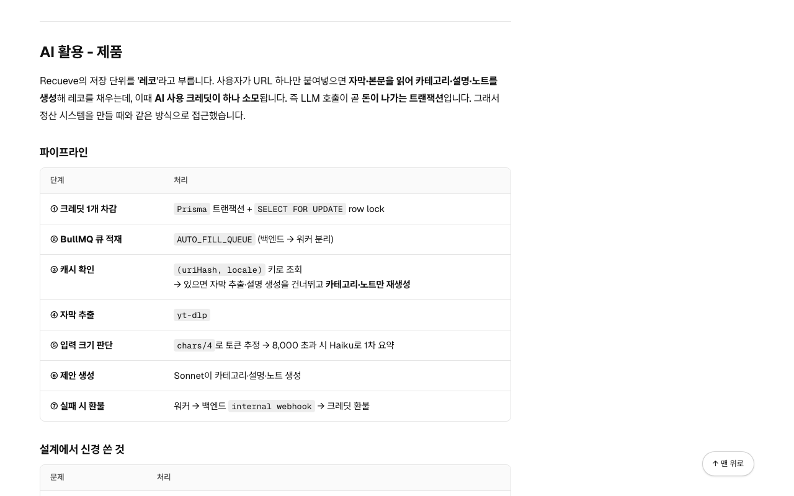 | 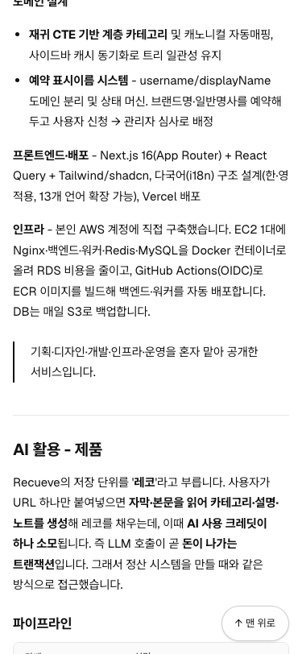 | 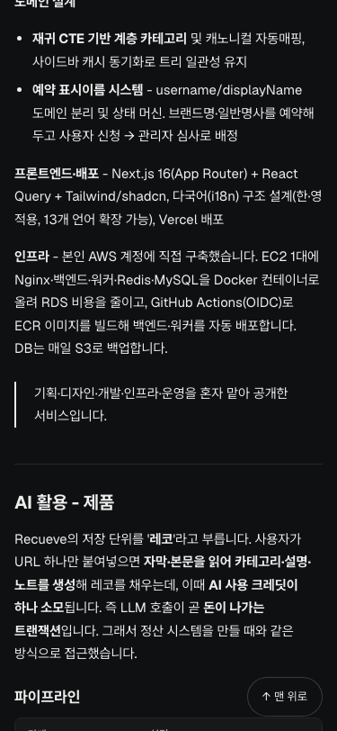 | 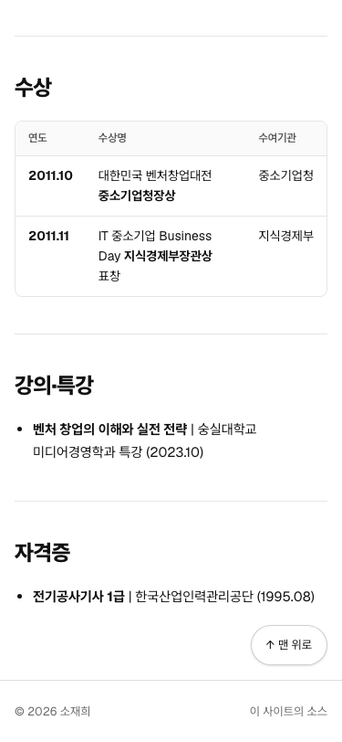 | 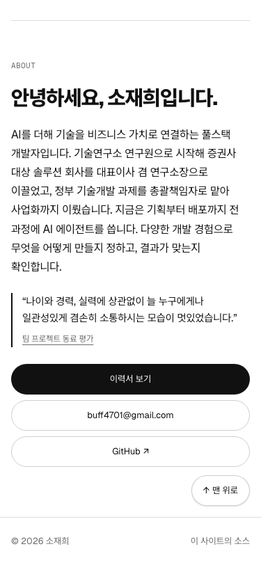 |

## 동료 평가에서 정한 값

홈 About의 동료 평가 세 줄과 이력서의 동료 평가 상자입니다(2026-10-17, [02-ia.md](02-ia.md#4-about)). 캡처는 [docs/design/peer-review/](design/peer-review/)에 있습니다.

| 항목 | 모바일 | 데스크톱 (`lg`, 64rem 이상) |
|---|---|---|
| 홈: 묶음 제목 "팀 프로젝트 동료 평가" | 0.75rem, `subtle` | 같음 |
| 홈: 인용 | 0.9375rem, 왼쪽 선 2 `fg`, 안쪽 0.875rem | 1.125rem, 안쪽 1.25rem |
| 홈: 인용 사이 | 1rem | 1.25rem |
| 홈: 출처 링크 | 0.75rem, 밑줄, 높이 1.5rem | 같음 |
| 이력서: 상자 | `surface` 바탕, 왼쪽 선 2 `accent`, 오른쪽 모서리 0.5rem, 안쪽 1rem 1.25rem | 같음 |
| 이력서: 머리글과 인용 사이 | 0.5rem | 같음 |
| 이력서 인쇄: 상자 | 바탕 없음, 왼쪽 선 2 `accent`, 안쪽 왼쪽 0.75rem | - |

- 홈은 세 인용을 위아래로 쌓습니다. 문장 길이가 달라 세 칸으로 나누면 높이가 들쭉날쭉합니다. About의 글 폭(48.75rem) 안에 둡니다.
- 이력서 상자는 사이트에 이미 있는 면 바탕과 강조색만 씁니다. 상자 안 인용은 왼쪽 선을 빼고 상자의 선 하나만 남깁니다.

| 홈 About (1280) | 홈 About (375) | 이력서 상자 (1280) | 이력서 상자 (375 다크) |
|---|---|---|---|
| 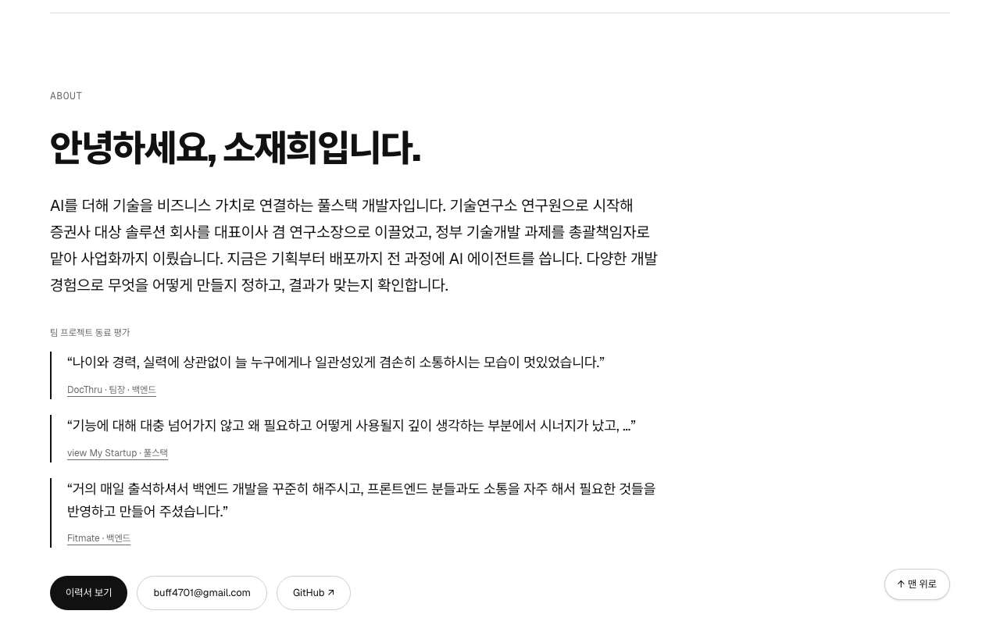 | 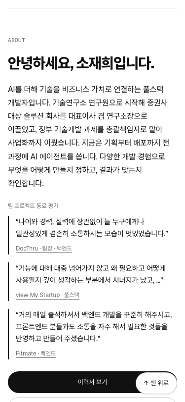 | 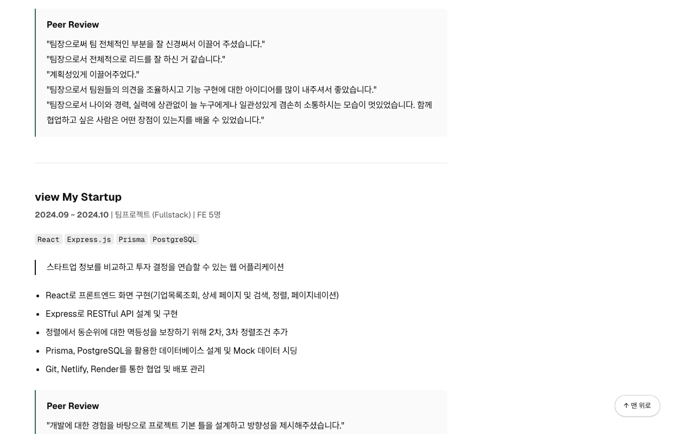 | 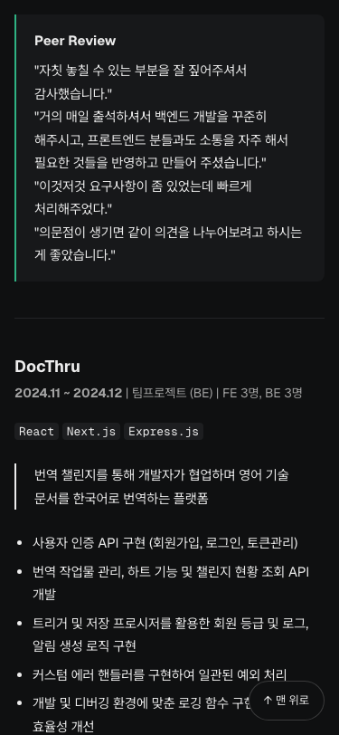 |

## 이력서 끝 사진에서 정한 값

이력서 본문 끝의 사진입니다(2026-10-17, [02-ia.md](02-ia.md#resume-이력서-f4)). 캡처는 [docs/design/resume-end-photo/](design/resume-end-photo/)에 있습니다.

| 항목 | 모바일 | 데스크톱 (`lg`, 64rem 이상) |
|---|---|---|
| 자리 | 본문 아래, 본문 열 왼쪽 정렬 | 같음 |
| 본문과 사이 | 4rem | 6rem |
| 너비 | 화면 폭(최대 30rem) | 30rem |
| 비율 | 16:9로 자르고 아래쪽(그네와 바다)을 남김 | 같음 |
| 모서리와 테두리 | 0.625rem, 테두리 1 `line` | 0.75rem, 테두리 1 `line` (둘 다 `/work` 캡처와 같음) |
| 인쇄 | 숨김 | - |

- 원본이 960×720이라 30rem보다 넓히면 레티나 화면에서 흐려집니다. 원본의 하늘이 넓어 16:9로 위쪽을 잘랐습니다.
- 첫 화면 밖이라 늦게 불러옵니다(`next/image` 기본값).
- 페이지 끝에서 맨 위로 버튼은 사진 아래, 푸터 위의 여백에 멈춥니다. 모바일에서도 사진과 겹치지 않습니다.

| 데스크톱 (1280) | 모바일 (375) | 모바일 다크 (375) |
|---|---|---|
| 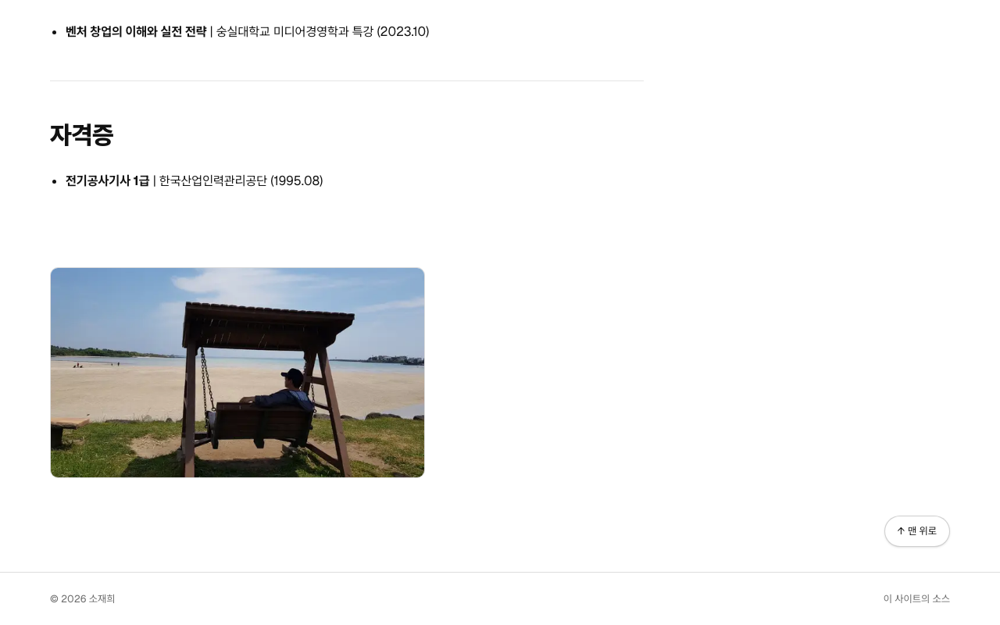 | 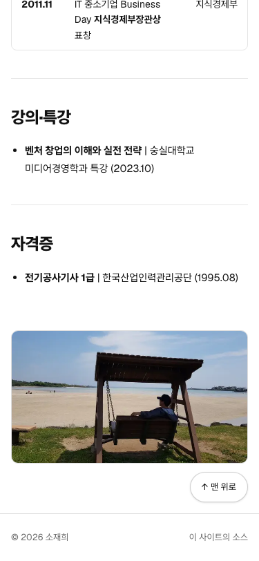 | 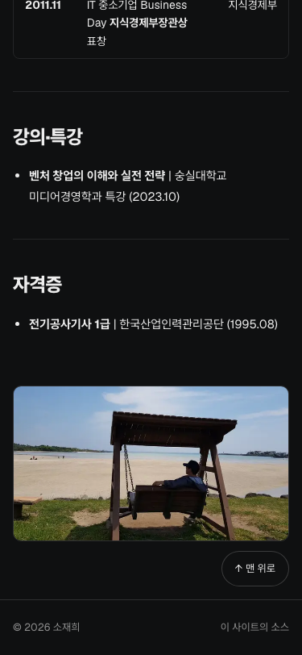 |

## 탭 아이콘에서 정한 값

탭 아이콘과 홈 화면 아이콘입니다(2026-10-17, [02-ia.md](02-ia.md#공통-요소)). Next.js 파일 규칙대로 `src/app/`에 두면 `<head>`에 연결됩니다.

| 파일 | 크기 | 모양 |
|---|---|---|
| `favicon.ico` | 16, 32, 48 (한 파일) | 얼굴을 원으로 자르고 바깥은 투명 |
| `icon.png` | 192 | 같음. 256색으로 줄여 약 10KB |
| `apple-icon.png` | 180 | 같은 얼굴을 사각형 그대로. iOS가 모서리를 깎으므로 투명하게 두지 않음 |

- 원본은 GitHub 프로필 일러스트(400×400)입니다. 헤더 그림(`src/assets/jake-avatar.png`)과 같은 자리(왼쪽 85, 위 15, 한 변 230)를 잘라 씁니다. 헤더 그림을 원본과 맞춰 보고 찾은 자리입니다.
- 원의 가장자리는 8배 크기로 그린 뒤 줄여 부드럽게 했습니다.
- 다크 모드용 아이콘은 따로 두지 않습니다. 어두운 탭에서도 파란 원이 보입니다.

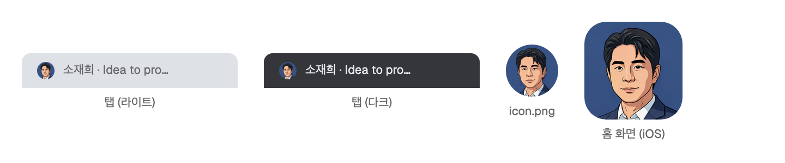

## 작업 순서

1. 실제 문구로 흑백 스토리보드를 그립니다(Design 캔버스). 박자별 모바일과 데스크톱 아트보드, 멈춘 뒤의 첫 화면 배치 2~3안. 캔버스는 비공개이므로, 정한 뒤에는 고른 안과 고르지 않은 안을 캡처해 `docs/design/<기능>/`에 남깁니다.
2. 고른 안을 구현합니다.
3. 색, 간격, 마감을 다듬습니다. 디자인 스킬로 화면을 검토하고, 정한 토큰을 이 문서에 기록합니다.

## 참고한 사이트

- [careerhackeralex.com](https://www.careerhackeralex.com/) - 홈에서 작업을 보여 주고 자세한 내용은 각 페이지로 보내는 구성, 짧은 사람 소개, 이력서는 링크로만 두는 것, 숫자 하나로 근거를 보이는 카드, 첫 장면 다시 보기 버튼, 인쇄용 이력서 페이지를 참고했습니다. 장면마다 배경색을 바꾸는 것과 스크롤에 따라 바뀌는 장면은 흑백에 강조색 하나라는 원칙과 1차 범위 때문에 가져오지 않았습니다.
