# 04. 첫 화면 움직임

- 상태: F1 구현 반영 (2026-10-15). 배치, 강조색, 다시 보기 자리는 F1 스토리보드에서 정했고(아래 "스토리보드에서 정한 것"), 박자별 시간과 세부 모양은 구현에서 정했습니다(아래 "구현에서 정한 것").
- 관련: [01-prd.md](01-prd.md#1차-mvp) F1 · [02-ia.md](02-ia.md#홈) · [03-design.md](03-design.md)

이 문서는 첫 화면 움직임의 지시서이자 검토 기준입니다. 무엇을 보여 줄지, 무엇을 하지 않을지, 박자마다 무엇이 일어나는지를 제가 정하고, 구현은 이 문서를 그대로 따릅니다. 결과가 이 문서와 다르면 문서를 먼저 고친 뒤 구현을 고칩니다.

## 목적

첫 줄 "Idea to production."은 아이디어에서 운영 중인 서비스까지 맡는다는 것을 짧게 말하고, 둘째 줄이 그 사이(기획, 디자인, 개발, 배포)를 한국어로 풀어 줍니다. 움직임은 그것을 어떻게 하는지 보여 줍니다. AI가 내놓는 것을 판단과 검증으로 걸러 실제 기술 층으로 쌓는 장면입니다. 보조 문장은 그 판단과 검증의 바탕이 AI 이전부터 쌓은 경험이라는 것을 말합니다. 움직임이 끝나면 같은 화면 안에 사실이 남습니다.

## 재료

| 재료 | 내용 | 출처 |
|---|---|---|
| 첫 줄 | Idea to production. | 이력서 자기소개("기획부터 개발, 배포까지 완주", "기획·디자인·개발·코드리뷰·테스트·배포까지 전 과정") |
| 둘째 줄 | 기획부터 디자인, 개발, 배포까지 전 과정을 다룹니다. | 첫 줄을 한국어로 받치는 사이트 문구. 사실은 이력서 자기소개 범위 |
| 조각 | AI가 내놓는 코드와 제안을 추상화한 짧은 막대 | |
| 관문 | 세로선 두 개와 이름: 판단, 검증 | |
| 기술 층 | 아래 표의 여섯 층 | 포트폴리오 "6. 기술 스택" |
| 보조 문장 | 속도는 AI로 내고, 판단과 검증은 AI 이전부터 쌓은 경험으로 합니다. | 이력서 자기소개("AI 코딩 도구가 등장하기 훨씬 전부터 다양한 로직을 직접 구현해 온 경험을 바탕으로") |
| 증거 목록 | 서비스 세 개의 이름, 한 줄 설명, 라이브 링크 | 포트폴리오 "1. 한눈에 보기" |
| 연락 | 이메일, GitHub, 이력서 보기 | 이력서 연락처 |

### 기술 층

| 층 | 기술 | 강조되는 서비스 |
|---|---|---|
| 화면 | Next.js, React, Tailwind | Recueve, ProWith, GENYS Lotto AI |
| API | NestJS, Node.js, TypeScript | Recueve, ProWith |
| 워커 | BullMQ, AWS Lambda, EventBridge | Recueve (자동 채움 워커), GENYS Lotto AI (회차 수집기) |
| 데이터 | PostgreSQL, Redis, Prisma | Recueve, ProWith, GENYS Lotto AI |
| 인프라 | AWS, Docker, Vercel | Recueve, ProWith, GENYS Lotto AI |
| AI | Claude Code, MCP, Claude API | Recueve (Claude API) |

워커 층은 API와 데이터 사이에 둡니다. 요청에 바로 답하는 서버와 뒤에서 오래 도는 작업을 나눠 설계한다는 점이 층의 순서로 드러나게 하기 위해서입니다. Redis는 큐의 저장소로도 쓰지만 캐시와 인증 토큰에도 쓰므로 데이터 층에 둡니다.

## 스토리보드에서 정한 것

| 항목 | 결정 |
|---|---|
| 배치 | A. 데스크톱은 글이 왼쪽, 여섯 층이 오른쪽, 증거 목록이 아래 띠입니다. 모바일은 첫 줄, 소개 두 줄, 여섯 층, 증거 목록, 이메일과 GitHub 순서로 위에서 아래로 쌓습니다 |
| 첫 줄 모양 | 데스크톱 두 줄("Idea to / production."), 모바일 두 줄 |
| 강조색 | 초록 `#0B7A52`. 관문을 통과했다는 뜻과 맞습니다. 흰 글자와의 대비는 5.4:1입니다. 다크 모드 값은 구현할 때 대비를 재서 정합니다 |
| 다시 보기 | 기술 층 아래 오른쪽. 모바일도 같은 자리입니다 |
| 서비스 목록 | 번호 01~03을 붙여 아래 서비스 카드와 맞춥니다. 이름을 누르면 해당 카드로 내려갑니다 |
| 층 테두리 | 2px(`border-2`). 스토리보드의 1.5px는 단위 규칙([03-design.md](03-design.md#원칙) 7번) 때문에 바꿨습니다 |

배치 B(가운데 무대)와 C(기술과 서비스 표)는 고르지 않았습니다. C의 표는 "운영 중인 서비스" 섹션의 후보로 [02-ia.md](02-ia.md#2-운영-중인-서비스)에 남겼습니다.

### 스토리보드 캡처

Design 캔버스에 실제 문구로 그린 스토리보드를 캡처해 `docs/design/f1/`에 두었습니다. 고르지 않은 안도 비교할 수 있게 함께 남깁니다.

| 배치 A (고름) | 배치 B | 배치 C |
|---|---|---|
| 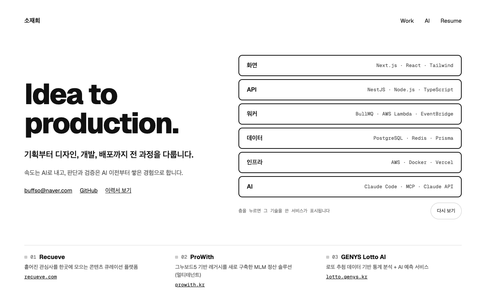 | 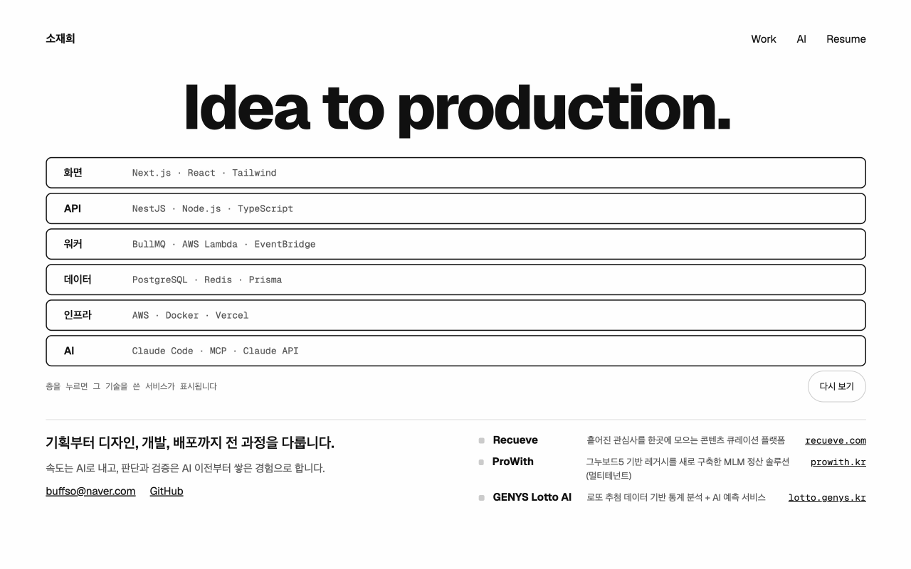 | 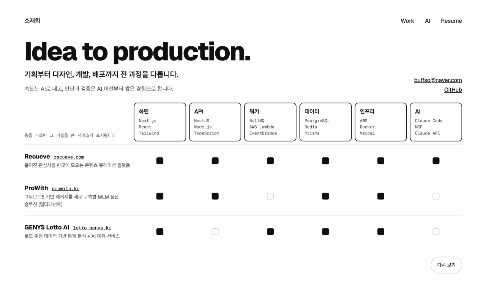 |
| 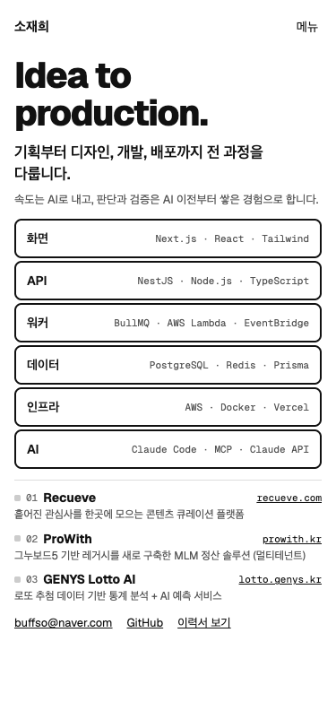 | 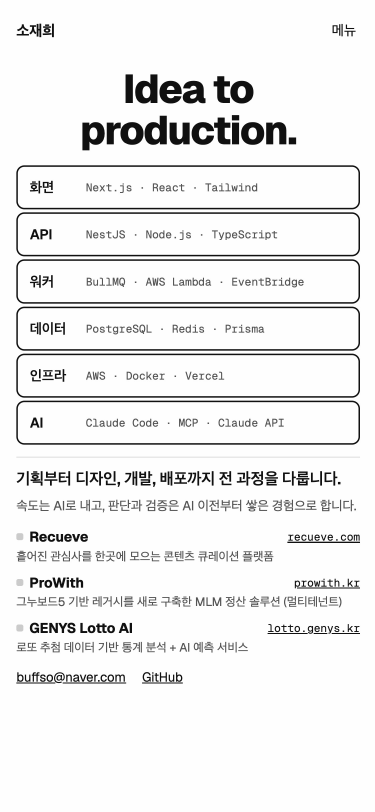 | 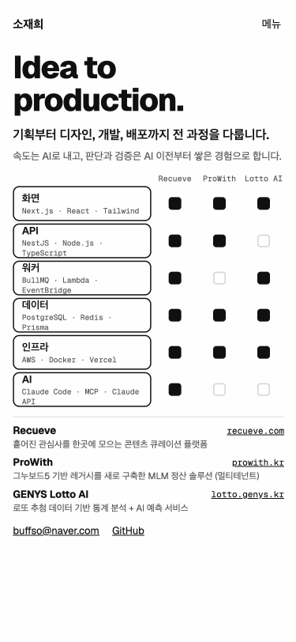 |

박자 1~4입니다. 박자 5(멈춤)는 배치 A와 같습니다.

| 박자 1 | 박자 2 | 박자 3 | 박자 4 |
|---|---|---|---|
| 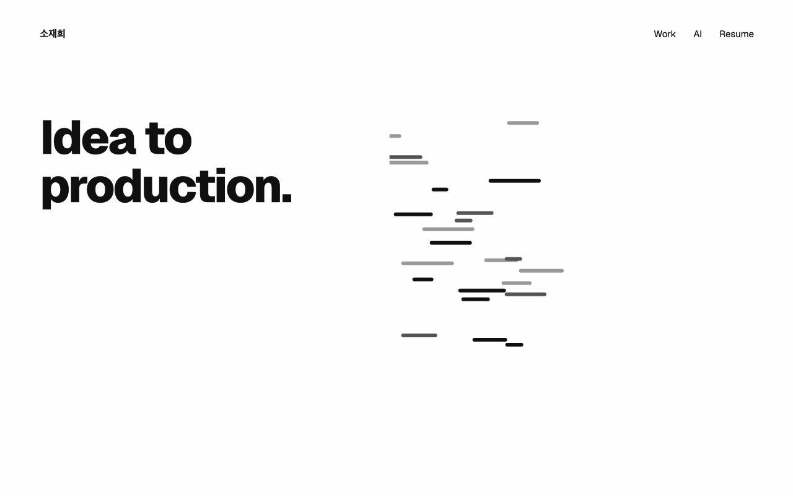 | 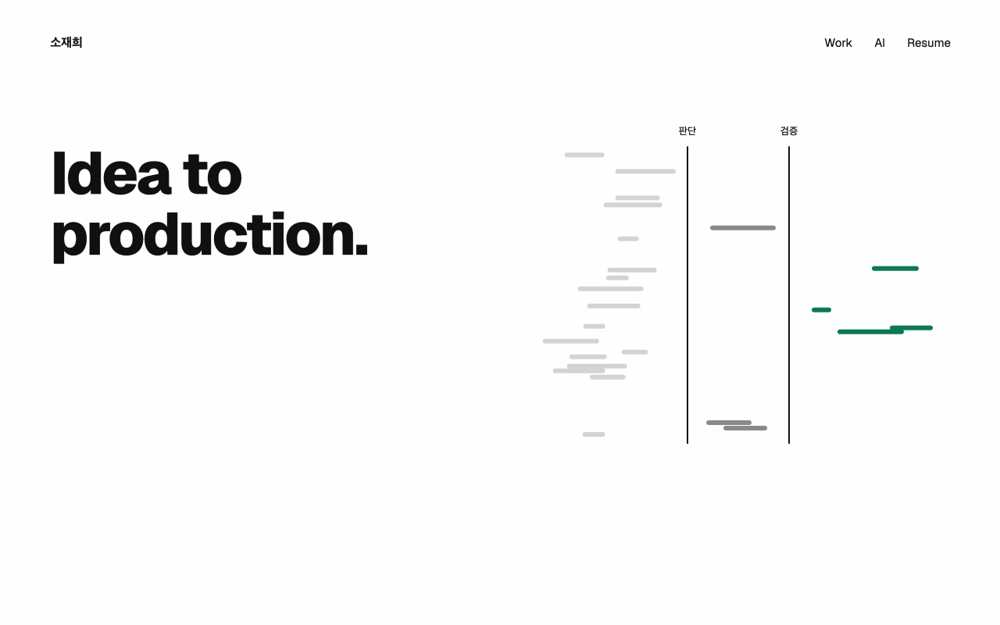 | 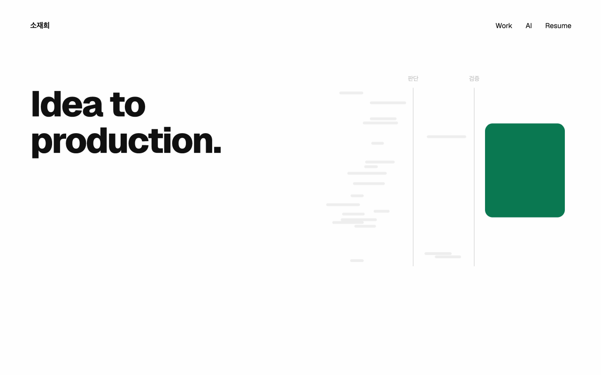 | 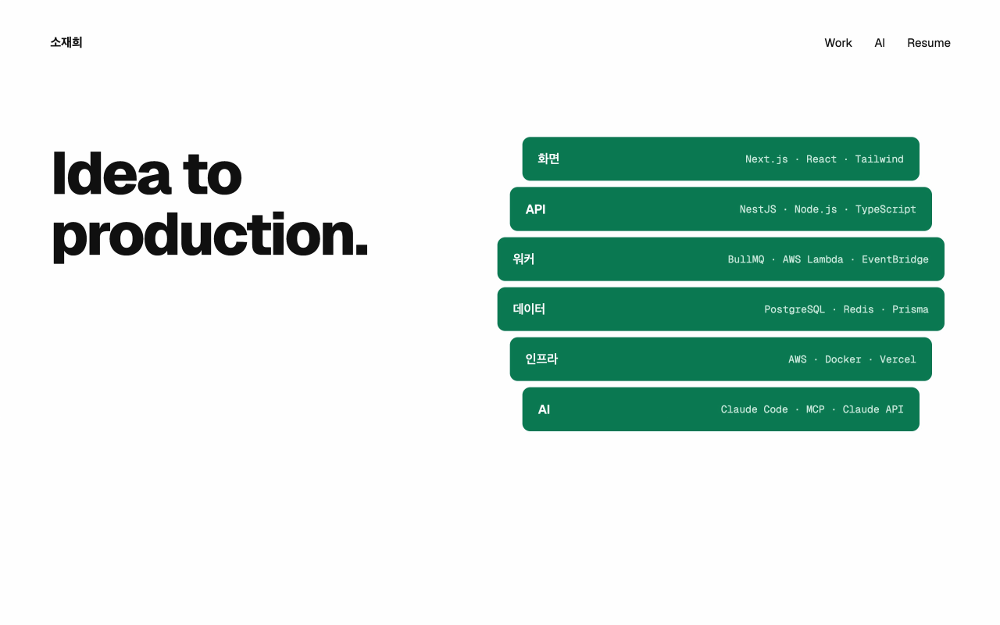 |
| 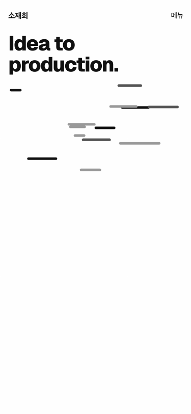 | 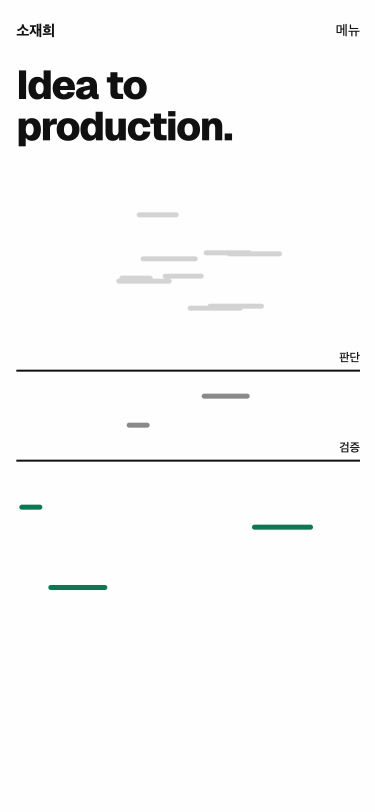 | 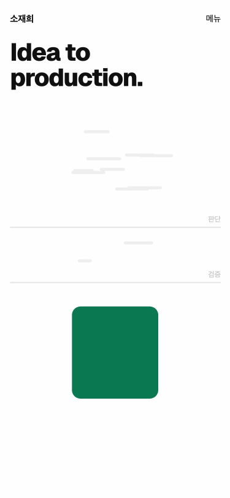 | 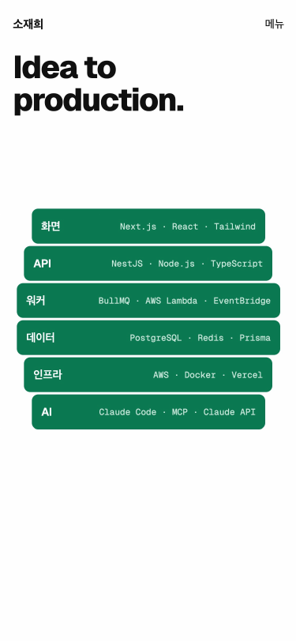 |

## 방향

- **끊기지 않는 하나의 흐름**: 장면을 자르지 않습니다. 앞 박자의 요소가 다음 박자의 요소가 됩니다.
- **절제되고 정확하게**: 튀지 않는 스프링 감속을 씁니다.
- **흑백에 강조색 하나**: 강조색은 관문을 통과한 조각과 그 뒤의 결과에만 씁니다. 멈춘 뒤에는 층을 눌렀을 때의 강조에 씁니다.
- **사람이 중심**: 장면의 중심은 관문(판단, 검증)입니다. AI는 재료를 내놓는 쪽으로만 표현합니다. AI가 혼자 결과를 만드는 것처럼 보이게 하지 않습니다.
- **도형은 사각형, 둥근 사각형, 선**만 씁니다(구현 방식 참고).

## 금지

- 튀는 이징(bounce, elastic), 파티클, 글로우, 그라데이션, 3D 회전, WebGL
- 로봇, 뇌, 반짝이 아이콘, 네온 회로 같은 흔한 AI 그림
- 템플릿처럼 보이는 모든 것
- 사실(글자와 링크)을 클릭이나 스크롤 뒤에 숨기는 것
- 멈춘 뒤에도 계속 반복되는 움직임
- 소리, 자동 재생 영상

## 박자

데스크톱은 합계 3초 이내, 모바일(375px)은 2.5초 이내입니다. 시간은 스토리보드에서 다듬습니다.

| 박자 | 데스크톱 | 모바일 |
|---|---|---|
| 1 | 첫 줄이 보이고, 한쪽에서 조각들이 흘러듭니다 | 조각 수를 줄입니다 |
| 2 | 조각이 판단과 검증 두 관문에 닿습니다. 대부분은 멈춰 흐려지고 몇 개만 통과합니다 | 관문은 가로선으로 위아래에 둡니다 |
| 3 | 통과한 조각이 둥근 사각형 하나로 응축됩니다 | 같음 |
| 4 | 그 사각형이 여섯 층으로 갈라지며 기술 이름이 붙습니다 | 층을 세로로 쌓습니다 |
| 5 | 둘째 줄과 보조 문장, 증거 목록, 이메일과 GitHub가 제자리에 나타나고 멈춥니다 | 같음 |

## 멈춘 뒤

- 층을 누르거나 마우스를 올리면, 그 층의 기술을 쓴 서비스가 증거 목록에서 강조됩니다.
- 작은 "다시 보기" 버튼으로 움직임을 다시 볼 수 있습니다.
- 같은 방문 중에 홈으로 다시 오면 움직임 없이 마지막 장면을 보여 줍니다.
- 멈춘 뒤에는 반복되는 움직임이 없습니다.

## 접근성과 성능

- `prefers-reduced-motion: reduce`이면 움직임 없이 마지막 장면만 보여 줍니다.
- 글자와 링크는 모두 실제 HTML입니다. 가장 큰 요소(LCP)는 첫 줄이고, 처음부터 보이게 그립니다.
- 첫 줄은 영어이므로 `lang="en"`을 붙여 스크린 리더가 바르게 읽게 합니다.
- 층은 버튼 요소로 만들어 키보드 포커스로도 강조됩니다.
- 첫 화면 움직임에 쓰는 클라이언트 코드는 gzip 10KB 이하입니다. 빌드 뒤 `npm run check:motion-size`가 재고, CI에서도 돕니다.
- 375px 화면에서 가로 스크롤이 없습니다.
- 배포 후 Lighthouse 성능과 접근성 90점 이상을 유지합니다.

## 구현 방식

- 라이브러리 없이 Web Animations API로 만듭니다. 스프링 감속은 스프링 곡선을 샘플링한 CSS `linear()`로 씁니다.
- 움직이는 속성은 `transform`, `opacity`, `clip-path`만 씁니다.
- SVG 경로 모양을 바꾸는 움직임(`d` 속성)은 쓰지 않습니다. Safari에서는 움직이지 않습니다. 그래서 응축된 도형은 사각형으로 만들고, 여섯 층은 그 사각형이 갈라진 조각으로 만듭니다.
- 서버가 그린 HTML이 마지막 장면입니다. 움직일 조건(움직임 줄이기가 아니고, 이번 방문의 첫 홈)일 때만 화면을 그리기 전에 시작 상태로 돌려 재생합니다. 재생이 실패하면 마지막 장면이 그대로 남습니다.
- 손으로 짜기 어려워지면 Motion의 `animate`로 올립니다. 의존성이 늘어나므로 그때 ADR을 씁니다.

## 구현에서 정한 것

코드는 `src/components/home/`의 `hero.tsx`(마지막 장면), `intro-script.ts`(시작 조건), `hero-intro.tsx`(시작과 다시 보기), `intro-play.ts`(재생)에 있습니다.

| 항목 | 결정 |
|---|---|
| 시작 조건 | 히어로 맨 앞의 인라인 스크립트가 그리기 전에 실행됩니다. 움직임 줄이기가 아니고 이번 방문(sessionStorage)에 재생한 적이 없으면 `data-intro`를 붙여 글과 층을 숨깁니다. 다른 페이지에서 링크로 처음 홈에 왔을 때는 같은 조건을 클라이언트가 봅니다 |
| 실패하면 | JS가 3초 안에 재생을 시작하지 못하면 인라인 스크립트가 `data-intro`를 지워 마지막 장면을 보여 줍니다. 재생 중 오류가 나도 무대를 걷어 내고 마지막 장면을 남깁니다 |
| 재생 코드 | 재생할 때만 불러옵니다. 다시 방문했거나 움직임 줄이기면 받지 않습니다. 용량은 gzip 2.2KB입니다 |
| 무대 | 조각, 관문, 사각형은 재생할 때만 기술 층 목록 자리에 만들고 끝나면 지웁니다. 평소 HTML에는 없습니다 |
| 시간 | 키프레임 시각은 3초 기준으로 적고, 데스크톱은 0.96배, 모바일은 0.8배로 재생합니다. 끝을 알리는 데 한두 프레임이 더 들어 처음에 데스크톱이 3.04초로 쟀기 때문입니다. 지금은 데스크톱 2.89초, 모바일 2.42초입니다 |
| 감속 | 임계 감쇠 스프링을 25점으로 샘플링한 `linear()`. 이를 지원하지 않는 브라우저는 `cubic-bezier(0.2, 0.8, 0.2, 1)` |
| 조각 | 데스크톱 24개, 모바일 14개. 배치는 스토리보드와 같은 식의 시드 난수로 정해 매번 같습니다. 6개 중 1개꼴로 관문을 통과합니다 |
| 관문 | 데스크톱은 무대 폭의 42%와 64%에 세로선, 모바일은 높이의 36%와 62%에 가로선 |
| 강조색으로 바뀌기 | 색은 움직이지 않으므로, 통과한 조각 위에 강조색 덮개를 얹고 그 opacity를 올립니다 |
| 여섯 층으로 갈라지기 | 강조색 조각 여섯이 사각형의 한 줄씩에서 시작해 실제 층 자리로 갑니다(transform). 스토리보드는 갈라진 조각에 기술 이름을 그렸지만, 구현에서는 실제 층 버튼이 그 자리에 나타나며 이름이 붙습니다 |
| 개발 모드 | React Strict Mode가 컴포넌트를 두 번 마운트해도, 재생 중에 사라지면 시작 상태로 돌려 다음 마운트가 처음부터 재생합니다 |

검증은 `e2e/intro.spec.ts`에 있습니다. 재생 시간, 같은 방문에서 다시 열 때 재생하지 않는 것, 다시 보기, JS를 막았을 때 3초 뒤 마지막 장면, 움직임 줄이기를 확인합니다. 다른 E2E는 움직임 줄이기로 돌려 마지막 장면만 봅니다.

## 참고

- 재료, 방향, 금지 목록, 박자로 나누는 이 문서의 형식은 Claude로 모션 그래픽을 만드는 [영상](https://www.youtube.com/watch?v=_kc0riDpxOY)의 프롬프트 구조를 참고했습니다.
